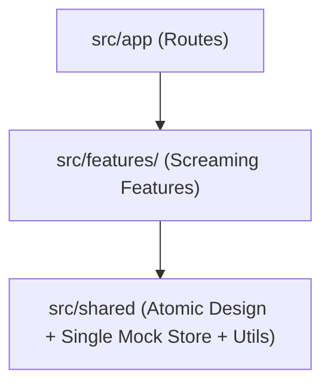

# AGENTS.md — Frontend Engineering Constitution & Poka-Yoke Playbook

This repository is a multi-project monorepo for the **Solidez MX** temporary-job marketplace platform.

> [!IMPORTANT]
> **100% FRONTEND-ONLY SCOPE (ZERO LIVE BACKEND CONSUMPTION):**
> The 3 projects in this repository (`movil-trabajador`, `movil-empleador`, `web-admin`) are **pure frontend applications**. Do NOT connect to a live Supabase instance, live PostgreSQL database, or live Stripe API during this phase.
> Instead, **all data that the frontend would normally consume from the backend MUST live in a single centralized Mock Seed & In-Memory Store/Service layer (`src/shared/mocks/mock-backend.seed.ts` + Zustand/Services)** with simulated network latency (`300ms–600ms`), state transitions, and deterministic error triggers.
> **Hardcoding data directly inside JSX/TSX components is strictly forbidden.** Components consume typed hooks/services as if a real backend existed.

Every developer and AI agent operating in this repository MUST follow this document to the letter. There is zero room for improvisation.

---

## 1. Quick Path & Hierarchy of Truth

### 1.1 The Golden Rule: Source of Truth Hierarchy

Whenever you are building a screen, form, or flow, you MUST cross-analyze the visual mocks against the Architecture Specification and obey this strict priority order:

1. **PRIMARY FUNCTIONAL SOURCE OF TRUTH (Always Wins):** [`docs/Especificacion_de_Arquitectura_de_Software_v2.md`](file:///home/anon/uni/cua9/integradora/docs/Especificacion_de_Arquitectura_de_Software_v2.md)
   - Defines all **34 operational flows (Hito 1)**, **state machine diagrams (Hito 2)**, **35 screens with exact inputs/outputs/states (Hito 3)**, **navigation trees (Hito 4)**, and **data models / business rules (Hito 5)**.
   - Supplemental type/constraint reference: [`docs/001_trabajos_temporales.sql`](file:///home/anon/uni/cua9/integradora/docs/001_trabajos_temporales.sql) (used strictly to know exact field names, enums, and validation rules for the frontend).
2. **VISUAL & AESTHETIC REFERENCE ONLY:** [`mocks/sahara/DESIGN.md`](file:///home/anon/uni/cua9/integradora/mocks/sahara/DESIGN.md) and [`mocks/`](file:///home/anon/uni/cua9/integradora/mocks) (`screen.png` + `code.html`)
   - The `mocks/` folders are **ONLY visual references** for the **Sahara — Warm Minimalism** aesthetic (colors, typography, spacing, card layouts, editorial feel).
   - **MANDATORY CROSS-ANALYSIS:** Before coding any mock from `mocks/`, you MUST compare its `code.html` against Section 3 (Hito 3) of [`docs/Especificacion_de_Arquitectura_de_Software_v2.md`](file:///home/anon/uni/cua9/integradora/docs/Especificacion_de_Arquitectura_de_Software_v2.md). **If an incoherence exists between `mocks/` and `Especificacion_de_Arquitectura_de_Software_v2.md` (missing fields, extra buttons, wrong categories, wrong status labels, or sample data), `Especificacion_de_Arquitectura_de_Software_v2.md` ALWAYS wins and the mock remains strictly a visual reference.**

### 1.2 Developer Startup Steps

1. **Identify your assigned project** (never modify two projects in the same branch):
   - [`movil-trabajador/`](file:///home/anon/uni/cua9/integradora/movil-trabajador) — Worker Mobile App (Expo 58 / React Native 0.88 / Expo Router)
   - [`movil-empleador/`](file:///home/anon/uni/cua9/integradora/movil-empleador) — Employer Mobile App (Expo 58 / React Native 0.88 / Expo Router)
   - [`web-admin/`](file:///home/anon/uni/cua9/integradora/web-admin) — Admin Web Panel (React 19 / Vite 8 / Tailwind CSS)
2. **Create a scoped branch off `main`** (`<type>/<project>/<feature-slug>`) — **NEVER work on `main`**.
3. **Remove initial template boilerplate** on the first setup commit (`src/components/animated-icon*`, `src/app/explore.tsx`, `src/constants/` in `movil-*`; default Vite counter and `App.css` in `web-admin`).
4. **Build from the Single Mock Data Script + Zustand Stores**, decompose UI into **Sahara Atomic Design** + **Screaming Architecture**, and pass **Extreme Adversarial Tests** before committing.

---

## 2. The Poka-Yoke Axiom (Mistake-Proofing by Design)

> **Axiom:** Assume BOTH the end-user AND the next developer will misunderstand anything that is not physically prevented by the UI, the type system, or the runtime validation layer. If a mistake is possible, your code is broken.

### 2.1 Poka-Yoke for the End-User (UI/UX Defensive Engineering)

| Threat / Mistake | Mandatory Poka-Yoke Guardrail |
| :--- | :--- |
| **Double-tap / Rage-click on CTAs** (payments, job publishing, code verification, case arbitration) | Every mutation trigger MUST lock immediately on first press (`isPending` / `isSubmitting` state), show an inline spinner, and disable all sibling actions until the simulated async service resolves. |
| **Invalid or malicious form input** | Validate via **Zod + React Hook Form** on blur AND submit. Block submission until valid. Enforce exact specification rules client-side: payment `>= $10.00 MXN` and `<= $100,000.00 MXN`, age `>= 18 years`, password policy (`>= 8 chars, 1 upper, 1 lower, 1 digit`), `skills`/`availability` `<= 300 chars`, attachments `<= 5 files` and `<= 10 MB` (`JPG/PNG` for job/profile photos, `JPG/PNG/PDF` for case/completion evidence). |
| **State-machine confusion** (user tries an action outside its time/state window) | Never show an enabled button for an illegal state transition (Hito 2 diagrams). Hide or disable with an explicit countdown/reason: e.g., `register_arrival` is locked until `start_at - 30 min`; completion code entry locks after **5 failed attempts** and automatically routes to the no-code evidence flow (`D-04`); location updates lock after **3 changes in a rolling 24h window**. |
| **Ambiguous financial actions** | Always display the full financial breakdown before confirmation: `Job Amount + 10% Platform Fee (rounded half-up to cents) = Total Charged MXN`. Require an explicit two-step confirmation modal for Escrow payment, arbitration settlement (`D-02`), account sanctions, or job cancellation. |
| **Unpredictable UI states** | Every screen MUST implement 4 explicit visual states: **Loading Skeleton** (warm linen shimmer while the mock service simulates latency, never a blank screen), **Empty State** (clear illustration + explanation + primary CTA when list is `[]`), **Error State** (human-readable message in Spanish + retry button), and **Success State**. |

### 2.2 Poka-Yoke for the Developer (Frontend Architecture Guardrails)

1. **Zero `any` / Zero Untyped Contracts:** TypeScript `strict: true` is mandatory. Every entity (`Profile`, `Job`, `JobPrivate`, `JobApplication`, `Payment`, `ChatMessage`, `Case`, `Review`, `Attachment`, `Notification`) MUST be strictly typed in `src/shared/types/domain.types.ts` matching Section 3 & Section 5 of [`docs/Especificacion_de_Arquitectura_de_Software_v2.md`](file:///home/anon/uni/cua9/integradora/docs/Especificacion_de_Arquitectura_de_Software_v2.md).
2. **Single Centralized Mock Backend Script (`src/shared/mocks/mock-backend.seed.ts`):**
   - All initial mock datasets that the frontend consumes as if coming from the backend MUST live in **ONE single canonical seed file per project**: `src/shared/mocks/mock-backend.seed.ts`.
   - **NEVER scatter hardcoded mock arrays across components, views, or random files.**
   - Store and service layers initialize their in-memory state exclusively from `src/shared/mocks/mock-backend.seed.ts`, and every user action (creating a job, applying, selecting a worker, sending a chat message, verifying a 6-digit code, resolving an arbitration case) MUST mutate the Zustand store through typed async service functions so the entire application flow works interactively end-to-end.
3. **Strict Privacy & Role Boundaries in Frontend Services:**
   - Even though data lives in the local mock store, your selector/service functions MUST enforce the exact privacy rules of the specification:
     - `searchJobsService()` and `getJobPublicService()` (`UI-TRAB-02`, `UI-TRAB-04`) MUST strip `exact_address`, `exact_latitude`, `exact_longitude`, and `employer_phone`, returning ONLY `neighborhood` and the discrete distance range (`'menos de 5 km'`, `'5 a menos de 10 km'`, `'10 a menos de 25 km'`, `'25 a 50 km'`, `'más de 50 km'`).
     - Exact address (`job_private`) and counterpart phone (`getCounterpartContactService`) are only returned by the service once `job.status` reaches `'assigned'` (and only for the selected worker).
     - `job_completion.code` (6-digit code) is readable ONLY in `movil-empleador` (`UI-EMP-09`). In `movil-trabajador` (`UI-TRAB-09`), the UI NEVER reads the code; it passes the typed 6 digits to `verifyCompletionCodeService(jobId, inputCode)`, which compares against the store, increments `attempts`, and returns `'ok' | 'invalid' | 'blocked' | 'expired'`.

---

## 3. Architecture: Screaming Architecture + Atomic Design

When someone opens `src/`, the folder tree MUST immediately scream **"Temporary Jobs Marketplace with Escrow & Arbitration"**, while shared visual building blocks follow **Atomic Design** under `src/shared/components/`.

### 3.1 Directory Structure Blueprint (`src/`)

```text
src/
├── app/                          # Routing layer ONLY (Expo Router in movil-*, React Router in web-admin)
│   ├── (auth)/                   # Thin route wrappers that render Feature Views
│   ├── (main)/                   # Zero business logic, zero direct store mutations here
│   └── _layout.tsx
│
├── features/                     # SCREAMING ARCHITECTURE — Business Domains
│   ├── <feature-name>/           # e.g., auth-onboarding, job-explorer, escrow-checkout
│   │   ├── components/           # Feature-specific domain components (coupled to this business rule)
│   │   ├── views/                # Full screen view assembled for the router
│   │   ├── hooks/                # Feature hooks (TanStack Query / Zustand selectors, UI state machines)
│   │   ├── services/             # Async in-memory services reading/mutating the centralized mock store
│   │   ├── schemas/              # Zod validation schemas & feature form types
│   │   ├── __tests__/            # Unit, integration & property-based adversarial tests
│   │   └── index.ts              # Public barrel export (NOTHING outside imports internal files)
│
├── shared/                       # Cross-cutting infrastructure & Design System
│   ├── components/               # ATOMIC DESIGN — Pure UI (Zero business/domain knowledge)
│   │   ├── atoms/                # Indivisible Sahara primitives (Button, Badge, Input, Text, Icon, Chip)
│   │   ├── molecules/            # Simple compositions (FormField, SearchBar, RatingStars, CountdownPill, EmptyState)
│   │   ├── organisms/            # Complex reusable UI shells (HeaderBar, BottomSheet, ConfirmationModal, EvidenceUploader)
│   │   └── templates/            # Page/Screen layout shells (SafeScreenLayout, SplitAdminLayout, FormScrollLayout)
│   ├── mocks/                    # SINGLE SOURCE OF MOCK DATA CONSUMED BY FRONTEND
│   │   ├── mock-backend.seed.ts  # THE single canonical script with all typed seed data (users, jobs, cases, payments, chats)
│   │   └── mock-backend.store.ts # Centralized Zustand in-memory DB store + latency/error simulator
│   ├── types/                    # Canonical domain types & enums (domain.types.ts) from Architecture Spec v2
│   ├── theme/                    # Sahara design tokens (colors, typography, spacing, shadows)
│   ├── hooks/                    # Generic technical hooks (useDebounce, useIdempotentAction, useCountdown)
│   └── utils/                    # Pure helpers (formatCurrencyMXN, Haversine distance, date/timezone helpers, errorMapper)
```

### 3.2 Dependency Direction Rules (Non-Negotiable)



- `src/shared/components/{atoms,molecules,organisms,templates}` **MUST NOT** import from `src/features/*` or read directly from `mock-backend.store.ts`. They receive data and callbacks strictly via props.
- `src/features/<feature-A>` **MUST NOT** import internal files from `src/features/<feature-B>`. Cross-feature communication happens via route params, `src/shared/mocks/mock-backend.store.ts`, or public `index.ts` contracts.
- `src/app/*` route files **MUST NOT** exceed ~40 lines: they read route params, check auth guards, and render `<FeatureScreenView />`.

### 3.3 Domain Features per Project

| Project | Mandatory Screaming Features (`src/features/`) |
| :--- | :--- |
| **`movil-trabajador`** | `auth-onboarding`, `job-explorer`, `location-radius`, `job-applications`, `stripe-onboarding`, `assigned-job-checkin`, `realtime-chat`, `job-completion`, `cases-support`, `employer-review`, `worker-profile`, `work-payment-history`, `notifications` |
| **`movil-empleador`** | `auth-onboarding`, `my-job-posts`, `job-publisher`, `applicants-selection`, `assigned-job-conditions`, `escrow-checkout`, `realtime-chat`, `job-completion-verify`, `cases-claims`, `worker-review`, `payment-history`, `employer-profile`, `notifications` |
| **`web-admin`** | `admin-auth`, `cases-inbox`, `claim-arbitration`, `support-tickets`, `content-moderation`, `account-sanctions`, `stripe-financial-monitor` |

---

## 4. Mandatory Frontend Tech Stack

| Layer | `movil-trabajador` & `movil-empleador` | `web-admin` |
| :--- | :--- | :--- |
| **Core & Routing** | Expo SDK 58 + React Native 0.88 + Expo Router | React 19 + Vite 8 + React Router |
| **Styling (Sahara)** | **NativeWind v4** (Tailwind CSS for RN) | **Tailwind CSS** |
| **Typography & Icons** | `expo-font` (`EB Garamond`, `Manrope`) + Material Symbols / `@expo/vector-icons` | Google Fonts (`EB Garamond`, `Manrope`) + Material Symbols Outlined |
| **Forms & Validation** | **React Hook Form + Zod** (`@hookform/resolvers/zod`) | **React Hook Form + Zod** (`@hookform/resolvers/zod`) |
| **State & Mock Services** | **Zustand** (in-memory mock DB + session) + **TanStack Query v5** (async service states/caching) | **Zustand** + **TanStack Query v5** |
| **Testing Arsenal** | **Jest (`jest-expo`) + React Native Testing Library + `fast-check` + Maestro (E2E)** | **Vitest + React Testing Library + `fast-check` + Playwright (E2E)** |

> **Expo Hierarchy Rule:** In `movil-trabajador` and `movil-empleador`, ALWAYS install packages with `npx expo install <package>`. This root `AGENTS.md` overrides any generic defaults in the sub-project `AGENTS.md` files, while retaining their Expo CLI commands (`npx expo lint`, `npx tsc --noEmit`).

---

## 5. How to Interpret Mocks & Cross-Check Against Architecture Spec v2

Each mock folder in [`mocks/`](file:///home/anon/uni/cua9/integradora/mocks) contains:
1. `screen.png` — Visual reference for layout hierarchy, spacing, and Sahara editorial feel.
2. `code.html` — Structural reference containing **Sahara Tailwind tokens**, typography classes, Material Symbols icon names, and Spanish UI labels.

> [!CAUTION]
> **TWO NON-NEGOTIABLE RULES WHEN READING `mocks/`:**
> 1. **ARCHITECTURE SPEC V2 IS THE SOURCE OF TRUTH OVER MOCKS:** Before writing a single component, cross-check `code.html` against [`docs/Especificacion_de_Arquitectura_de_Software_v2.md`](file:///home/anon/uni/cua9/integradora/docs/Especificacion_de_Arquitectura_de_Software_v2.md). Whenever `code.html` diverges from the Architecture Spec (e.g., extra buttons, missing fields, wrong status names, wrong categories), **discard the divergence in the mock and implement what `Especificacion_de_Arquitectura_de_Software_v2.md` defines.** The mock is ONLY a visual/aesthetic reference.
> 2. **NEVER HARDCODE MOCK SAMPLE DATA IN COMPONENTS:** The sample strings inside `code.html` (`"Mateo Villalobos Cruz"`, `"Narvarte Poniente"`, `"$850.00 MXN"`, `"CASO #ARB-2025-0418"`, pre-filled `value="..."` attributes) are for visual illustration only. **Components MUST render data dynamically from `src/shared/mocks/mock-backend.seed.ts` via hooks and props.**

### 5.1 Known Incoherences Between `mocks/` and `Especificacion_de_Arquitectura_de_Software_v2.md` (Already Audited — Follow the Spec!)

Developers MUST apply these corrections when translating the mocks:

| Screen / Mock | What Appears in `code.html` (Mock Incoherence) | What `Especificacion_de_Arquitectura_de_Software_v2.md` Mandates (SOURCE OF TRUTH) |
| :--- | :--- | :--- |
| **`UI-TRAB-01` & `UI-EMP-01`** (`auth-onboarding`) | Shows a `"Soy Trabajador / Soy Empleador"` role toggle pill, Google/Apple ID OAuth buttons, and an `"Electricidad"` trade chip during registration. | • **No Role Switcher in Mobile APKs:** `movil-trabajador` registers ONLY `role = 'worker'`; `movil-empleador` registers ONLY `role = 'employer'`.<br/>• **No OAuth:** Auth is strictly Email + Password + Email Verification (`D-09`, Section 3.2/3.3). Strip Google/Apple buttons.<br/>• **Exact Inputs:** `full_name`, `email`, `password`, `phone`, `birth_date` (`>= 18`), and mandatory checkboxes for `terms` and `privacy` (`D-10`). |
| **`UI-TRAB-02`** (`job-explorer`) | Shows distance badge `"A menos de 2 km"` and trade filter pills. | • **Official Distance Ranges (Hito 3.3):** Must use the 5 official range labels: `'menos de 5 km'`, `'5 a menos de 10 km'`, `'10 a menos de 25 km'`, `'25 a 50 km'`, `'más de 50 km'`, plus the `'Fuera de alcance'` tag (max 10 out-of-range jobs).<br/>• **Official Categories:** Strictly `'limpieza'`, `'pintura'`, `'jardineria'`, `'mudanzas'`, `'eventos'`, `'otros'`. |
| **`UI-TRAB-10`** (`cases-support` — Worker) | There is no `ui_trab_10_*` folder inside `mocks/movil-trabajador/` (numbering jumps from `09` to `11`). | • **Mandatory Screen in Hito 3.3 (`UI-TRAB-10`):** You MUST build `UI-TRAB-10` (*Centro de Casos y Soporte*) following Hito 3.3 and Hito 4.2, reusing the exact Sahara visual layout of `mocks/movil-empleador/ui_emp_10_abrir_caso_o_reclamaci_n` (creation form) and `ui_emp_14_mis_casos_y_tickets` (list, detail thread, and 7-day resolution objection). |
| **`UI-EMP-04` & `UI-EMP-05`** (`applicants-selection`) | `mocks/movil-empleador/ui_emp_04_detalle_y_postulantes` combines job details and applicant list, without a separate `ui_emp_05` folder. | • **Two Distinct Views in Hito 3.2 & Hito 4.1:** Implement `UI-EMP-04` (*Detalle de Publicación y Postulantes* with edit/cancel pre-selection) AND `UI-EMP-05` (*Perfil del Candidato Postulado* showing `full_name`, `photo_path`, `skills`, `availability`, rating average, `reviews`, and the `"Seleccionar candidato"` CTA that starts the 24h countdown). |
| **`UI-EMP-07` & `UI-TRAB-06`** (Stripe Screens) | Static payment/onboarding screens in HTML. | • **Frontend Simulation of Stripe Flows:** In `UI-TRAB-06`, clicking `"Vincular cuenta Stripe Connect"` opens a simulated Stripe Connect hosted onboarding modal/step that toggles `stripe_onboarding_complete = true` in the mock store. In `UI-EMP-07`, clicking `"Pagar en Escrow"` opens a simulated Stripe PaymentSheet modal (with test cards: Success, Declined, Network Error) that transitions the job to `'in_progress'` and payment to `'confirmed'`. |

### 5.2 What to Extract vs. What to Strip from `code.html` (The De-Mocking Matrix)

| Element in `code.html` | Classification | Mandatory Developer Action in React / React Native |
| :--- | :--- | :--- |
| **Sahara Colors, Fonts & Elevation** (`bg-surface`, `text-primary`, `font-headline`, `rounded-xl`, `shadow-sm`) | **KEEP (Visual Contract)** | Extract into `tailwind.config` and `src/shared/theme/` tokens. Reuse across Atomic Design components. |
| **Static UI Labels, Section Headers & Placeholders** (`"Nombre y apellidos completos"`, `placeholder="Como figura en tu INE / CURP"`, `"Trabajos disponibles"`) | **KEEP (UI Copy)** | Keep as static Spanish UI labels/placeholders inside the component or constants. |
| **Pre-filled Form Input Values & Checked States** (`value="Mateo Villalobos Cruz"`, `value="55 4920 1832"`, `value="22 / 05 / 1996"`, `value="S0lid3z#Trabaj026"`, `checked=""`) | **FORBIDDEN IN FORMS — STRIP!** | Create forms MUST initialize **empty** (`defaultValues: { full_name: '', email: '', phone: '', ... }`) controlled by **React Hook Form + Zod**. Never ship pre-filled forms unless editing an existing record loaded by ID from the mock store. |
| **Computed Badges & Validation Feedback** (`"29 años • Elegible"`, `"Fuerte"`, `"1/3 cambios usados hoy (24h)"`, `"SLA: 18h restantes"`, `"3"` job counter) | **DYNAMIC COMPUTED STATE — NEVER HARDCODE!** | Compute dynamically at runtime from live form state or store data: calculate age from `birth_date` input (`>= 18`), compute password strength from current password value, compute remaining location changes from `workerLocation.recent_changes.length`, and count `jobs.length`. |
| **Repeated Static Cards / List Items / Chat Bubbles** (`<!-- TARJETA 1 -->`, `<!-- TARJETA 2 -->`, hardcoded chat messages between `"Casa Tierra Estudio"` and `"Mateo Villalobos"`) | **TEMPLATE INSTANCE — CONVERT TO `<FlatList>` / `.map()`!** | Extract **ONE** reusable Atom/Molecule/Organism (`<JobCard job={item} />`, `<ChatBubble message={msg} />`, `<TimelineEvent event={ev} />`). Render the collection dynamically from the service hook. If the array is `[]`, render `<EmptyState />`. |
| **Fictitious Names, Amounts, Neighborhoods, Ratings & IDs** (`"Mariana O."`, `"4.9 (12 reseñas)"`, `"$850.00 MXN"`, `"Col. Narvarte Poniente"`, `"#CT-88412"`, `"#ARB-2025-0418"`) | **MOVE TO `mock-backend.seed.ts` — NEVER IN JSX!** | Move sample records into `src/shared/mocks/mock-backend.seed.ts` as typed entities, and pass them into components strictly via props/hooks (`job.title`, `formatCurrencyMXN(job.fixed_payment_mxn)`, `job.neighborhood`, `job.distance_range`). |
| **Inline `<script>` Tags & DOM Manipulation** (`document.getElementById`, `classList.remove`, `onsubmit="event.preventDefault()"`) | **FORBIDDEN IN REACT — CONVERT TO HOOKS/STATE!** | Never use DOM selectors. Convert to declarative React state (`useState`, React Hook Form, or Zustand) and typed event handlers (`onPress`, `onSubmit`). |

### 5.3 Concrete Example: Wrong (Hardcoded JSX) vs. Right (Driven by Mock Service + Props)

```tsx
// ❌ FORBIDDEN (Hardcoding sample data from code.html inside a component — INSTANT PR REJECTION)
export function JobCard() {
  return (
    <View className="bg-surface-container-lowest p-4 rounded-lg">
      <Text className="font-headline font-bold">Limpieza profunda de oficina</Text>
      <Text>Col. Narvarte Poniente</Text>
      <Text className="text-primary font-bold">$850.00 MXN</Text>
      <Text>A menos de 2 km</Text>
      <Text>Mariana O. • 4.9 (12 reseñas)</Text>
    </View>
  );
}

// ✅ MANDATORY (Pure component receiving typed data from the mock service layer)
interface JobCardProps {
  job: PublicJobSummary; // Defined in src/shared/types/domain.types.ts (from Spec v2)
  onPress: (jobId: string) => void;
}

export function JobCard({ job, onPress }: JobCardProps) {
  return (
    <Pressable
      onPress={() => onPress(job.id)}
      accessibilityRole="button"
      className="bg-surface-container-lowest p-4 rounded-lg border border-outline-variant/50"
    >
      <Text className="font-headline text-headline-sm text-on-surface font-bold">
        {job.title}
      </Text>
      <Text className="font-label text-label-md text-on-surface-variant">
        {job.neighborhood}
      </Text>
      <Text className="font-headline text-headline-md text-primary font-bold">
        {formatCurrencyMXN(job.fixed_payment_mxn)}
      </Text>
      <DistanceRangeBadge range={job.distance_range} isOutOfRange={job.out_of_range} />
      <EmployerRatingSummary
        name={job.employer_name}
        ratingAvg={job.employer_rating}
      />
    </Pressable>
  );
}
```

### 5.4 Design System & Single Seed Script Contract (`src/shared/mocks/mock-backend.seed.ts`)

1. **Sahara Tokens (`src/shared/theme/` & `tailwind.config`):**
   - `primary`: `#c2652a` (Burnt sienna)
   - `surface` / `background`: `#faf5ee` (Warm linen — **NEVER use pure cold white `#ffffff` as page background**)
   - `surface-container-lowest`: `#ffffff` (Cards/Inputs only)
   - `surface-container-low`: `#f6f0e8`, `surface-container`: `#f2ece4`, `surface-container-high`: `#ece6dc`
   - `on-surface`: `#3a302a`, `on-surface-variant`: `#605850`
   - `tertiary`: `#8c3c3c` (Dusty rose), `error`: `#c0392b`, `outline-variant`: `#d8d0c8`
   - Fonts: `font-headline` = `EB Garamond`, `font-body` / `font-label` = `Manrope`.
2. **What `src/shared/mocks/mock-backend.seed.ts` MUST contain:**
   - **Seed Profiles:** Active worker, active employer, worker without Stripe onboarding (`stripe_onboarding_complete: false`), suspended user (`account_status: 'suspended'`), and admin account.
   - **Seed Jobs Across All Lifecycle States (Hito 2.1):** Jobs in `'published'`, `'has_applications'`, `'assigned'` (with 24h `selection_expires_at` and `selection_round`), `'arrival_registered'`, `'in_progress'` (with 6-digit code in `job_completion`), `'completion_requested'`, `'in_claim'`, `'completed'`, `'cancelled'`, and `'expired'`.
   - **Seed Cases Across All Types (Hito 2.2):** Claims (`'claim'`), Support Tickets (`'ticket'`), Content/User Reports (`'report'`), plus `case_messages`, `attachments`, `payments`, `stripe_events`, and `notifications`.
   - **Simulation Controls in `mock-backend.store.ts`:** A reset function (`resetMockDb()`) and a scenario/latency helper so developers and automated tests can trigger `loading`, `empty`, and specific `ERR_*` business errors deterministically.

### 5.5 Complete Screen-to-Feature & Mock Service Routing Map

#### A. Worker Mobile App (`movil-trabajador` ← `mocks/movil-trabajador/`)

| Mock Directory | Spec ID (Hito 3.3) | Target Feature (`src/features/`) | Mock Store Services to Implement (`services/`) |
| :--- | :--- | :--- | :--- |
| `ui_trab_01_auth_onboarding_trabajador` | **UI-TRAB-01** | `auth-onboarding` | `loginWorker`, `registerWorker`, `verifyEmailCode`, `acceptTerms`, `resetPassword` |
| `ui_trab_02_explorador_de_trabajos` | **UI-TRAB-02** | `job-explorer` | `searchJobsByRadius` (Haversine sort + distance range labels + max 10 out-of-range) |
| `ui_trab_03_configuraci_n_de_ubicaci_n_y_radio` | **UI-TRAB-03** | `location-radius` | `getWorkerLocation`, `saveWorkerLocation` (enforces max 3 changes in rolling 24h) |
| `ui_trab_04_detalle_y_postulaci_n` | **UI-TRAB-04** | `job-explorer` / `job-applications` | `getJobPublicDetail`, `applyToJob` (enforces unique application per job) |
| `ui_trab_05_mis_postulaciones` | **UI-TRAB-05** | `job-applications` | `listMyApplications`, `withdrawApplication` (only when `status === 'pending'`) |
| `ui_trab_06_onboarding_stripe_connect` | **UI-TRAB-06** | `stripe-onboarding` | `getStripeAccountStatus`, `completeSimulatedStripeOnboarding` |
| `ui_trab_07_trabajo_asignado_y_check_in` | **UI-TRAB-07** | `assigned-job-checkin` | `getAssignedJobPrivateDetail`, `confirmJobConditions`, `registerArrival`, `getCounterpartContact` |
| `ui_trab_08_chat_en_tiempo_real_trabajador` | **UI-TRAB-08** | `realtime-chat` | `listChatMessages`, `sendChatMessage`, `reportChatMessage` |
| `ui_trab_09_finalizaci_n_de_trabajo` | **UI-TRAB-09** | `job-completion` | `verifyCompletionCode` (5-attempt lockout → `D-04`), `requestCompletionWithoutCode`, `renewCompletionCode` |
| *(Reuse visual layout of `ui_emp_10` & `ui_emp_14` per Spec UI-TRAB-10)* | **UI-TRAB-10** | `cases-support` | `listMyCases`, `getCaseThread`, `openCaseOrClaim`, `sendCaseReply`, `objectCaseResolution` |
| `ui_trab_11_evaluaci_n_del_trabajador_al_empleador` | **UI-TRAB-11** | `employer-review` | `submitEmployerReview`, `getJobReviews` |
| `ui_trab_12_perfil_y_ajustes_trabajador` | **UI-TRAB-12** | `worker-profile` | `getWorkerProfile`, `updateWorkerProfile` (`skills <= 300`, `availability <= 300`, `photo_path`) |
| `ui_trab_13_historial_de_trabajos_y_pagos_trabajador` | **UI-TRAB-13** | `work-payment-history` | `listWorkerCompletedJobsAndTransfers` (from `jobs` + `payments`) |
| `ui_trab_14_notificaciones_y_alertas` | **UI-TRAB-14** | `notifications` | `listNotifications`, `markNotificationAsRead`, `registerDeviceToken` |

#### B. Employer Mobile App (`movil-empleador` ← `mocks/movil-empleador/`)

| Mock Directory | Spec ID (Hito 3.2) | Target Feature (`src/features/`) | Mock Store Services to Implement (`services/`) |
| :--- | :--- | :--- | :--- |
| `ui_emp_01_auth_onboarding_empleador` | **UI-EMP-01** | `auth-onboarding` | `loginEmployer`, `registerEmployer`, `verifyEmailCode`, `acceptTerms`, `resetPassword` |
| `ui_emp_02_feed_mis_publicaciones` | **UI-EMP-02** | `my-job-posts` | `listEmployerJobsByStatus` (with applicant counters) |
| `ui_emp_03_publicar_trabajo` | **UI-EMP-03** | `job-publisher` | `createJobPost`, `updateJobPost` (only pre-selection), `uploadJobPhotos` (max 5 JPG/PNG) |
| `ui_emp_04_detalle_y_postulantes` | **UI-EMP-04 & UI-EMP-05** | `applicants-selection` | `getEmployerJobDetail`, `listJobApplicants`, `getApplicantPublicProfile` (`UI-EMP-05`), `selectWorker` (starts 24h timer & increments `selection_round`), `rejectApplication`, `cancelJobPreSelection` |
| `ui_emp_06_trabajo_asignado_y_condiciones` | **UI-EMP-06** | `assigned-job-conditions` | `getAssignedJobStatus`, `confirmJobConditions`, `getCounterpartContact` |
| `ui_emp_07_checkout_stripe_escrow` | **UI-EMP-07** | `escrow-checkout` | `getEscrowPaymentBreakdown` (`amount + 10% fee`), `processSimulatedEscrowPayment` (max 3 attempts / 30 min window) |
| `ui_emp_08_chat_en_tiempo_real_empleador` | **UI-EMP-08** | `realtime-chat` | `listChatMessages`, `sendChatMessage`, `reportChatMessage` |
| `ui_emp_09_finalizaci_n_de_trabajo` | **UI-EMP-09** | `job-completion-verify` | `getEmployerCompletionCode` (6 digits + 24h expiry), `respondToCompletionRequest` (confirm or dispute → opens claim) |
| `ui_emp_10_abrir_caso_o_reclamaci_n` | **UI-EMP-10** | `cases-claims` | `openCaseOrClaim` (with max 5 evidence attachments) |
| `ui_emp_11_evaluaci_n_y_calificaci_n_del_empleador` | **UI-EMP-11** | `worker-review` | `submitWorkerReview` |
| `ui_emp_12_historial_de_trabajos_y_pagos_empleador` | **UI-EMP-12** | `payment-history` | `listEmployerJobsAndPayments` (from `jobs` + `payments`) |
| `ui_emp_13_perfil_y_ajustes_empleador` | **UI-EMP-13** | `employer-profile` | `getEmployerProfile`, `updateEmployerProfile`, `logoutEmployer` |
| `ui_emp_14_mis_casos_y_tickets` | **UI-EMP-14** | `cases-claims` | `listMyCases`, `getCaseThread`, `sendCaseReply`, `objectCaseResolution` (within 7 days) |
| *(Reuse `ui_trab_14` per Spec Hito 4)* | **UI-EMP-NT** | `notifications` | `listNotifications`, `markNotificationAsRead` |

#### C. Admin Web Panel (`web-admin` ← `mocks/web/`)

| Mock Directory | Spec ID (Hito 3.1) | Target Feature (`src/features/`) | Mock Store Services to Implement (`services/`) |
| :--- | :--- | :--- | :--- |
| `ui_adm_01_login_administrador` | **UI-ADM-01** | `admin-auth` | `loginAdmin` (enforces `role === 'admin'`), `requestAdminPasswordReset` |
| `ui_adm_02_bandeja_de_casos` | **UI-ADM-02** | `cases-inbox` | `listAllCases` (filter by `case_type`, `status`, date range, assigned admin), `assignCaseToAdmin` |
| `ui_adm_03_arbitraje_de_reclamaci_n` | **UI-ADM-03** | `claim-arbitration` | `getClaimArbitrationDossier` (job history, read-only chat, attachments, escrow payment), `resolveClaimArbitration` (`D-02` validation + 7-day `auto_close_deadline`), `closeClaimAndExecutePayout` |
| `ui_adm_04_atenci_n_de_tickets_y_soporte` | **UI-ADM-04** | `support-tickets` | `listSupportTickets`, `replyToSupportTicket`, `transitionTicketStatus` (`open -> in_review -> resolved -> closed`) |
| `ui_adm_05_moderaci_n_de_contenido` | **UI-ADM-05** | `content-moderation` | `listContentReports`, `executeModerationAction` (`'hide' | 'remove' | 'restore' | 'dismiss'` with mandatory `reason`) |
| `ui_adm_06_gesti_n_y_sanci_n_de_cuentas` | **UI-ADM-06** | `account-sanctions` | `searchUserAccounts`, `applyAccountSanction` (`'warning' | 'suspension_1d' | 'suspension_7d' | 'suspension_30d' | 'permanent_block' | 'soft_delete'`), `handleSanctionAppeal` |
| `ui_adm_07_monitoreo_financiero_stripe` | **UI-ADM-07** | `stripe-financial-monitor` | `listStripeWebhookEvents`, `listPaymentOperations`, `retryFailedPaymentOperation` |

---

## 6. Exhaustive Validation & Error-Handling Catalog (Zero-Guesswork Poka-Yoke)

To prevent any developer from inventing arbitrary validation rules or displaying raw error codes (`ERR_FORBIDDEN`), **every form and mock service MUST enforce the exact rules and error mappings below** (extracted from [`docs/Especificacion_de_Arquitectura_de_Software_v2.md`](file:///home/anon/uni/cua9/integradora/docs/Especificacion_de_Arquitectura_de_Software_v2.md) and [`docs/001_trabajos_temporales.sql`](file:///home/anon/uni/cua9/integradora/docs/001_trabajos_temporales.sql)).

### 6.1 Mandatory Client-Side Zod Validation Matrix

Every input MUST be trimmed (`.trim()`) and validated before calling any service:

| Domain / Entity | Field | Exact Constraint (Zod) | Mandatory User-Facing Error Message (Spanish) |
| :--- | :--- | :--- | :--- |
| **Auth & Profile** (`profiles`) | `full_name` | `trim().length >= 2` and `<= 150` chars | `"Ingresa tu nombre completo (mínimo 2 y máximo 150 caracteres)."` |
| **Auth & Profile** (`profiles`) | `email` | Valid RFC 5322 email, lowercase, trimmed | `"Ingresa un correo electrónico válido."` |
| **Auth & Profile** (`profiles`) | `password` | `>= 8` chars, `>= 1` uppercase, `>= 1` lowercase, `>= 1` digit | `"La contraseña debe tener al menos 8 caracteres, una mayúscula, una minúscula y un número."` |
| **Auth & Profile** (`profiles`) | `phone` | Regex `^[0-9+() -]{8,20}$` (`8` to `20` chars) | `"Ingresa un número telefónico válido (8 a 20 dígitos)."` |
| **Auth & Profile** (`profiles`) | `birth_date` | `<= CURRENT_DATE - 18 years` (exact day check) | `"Debes ser mayor de 18 años para registrarte en la plataforma."` |
| **Auth & Profile** (`terms_acceptances`) | `terms` & `privacy` | Both checkboxes strictly `true` (`document IN ('terms', 'privacy')`) | `"Debes aceptar los Términos de Uso y el Aviso de Privacidad para continuar."` |
| **Worker Profile** (`profiles`) | `skills`, `availability` | `<= 300` chars each (NULL for `employer` role) | `"El texto no puede exceder los 300 caracteres."` |
| **Worker Location** (`worker_locations`) | `latitude`, `longitude`, `search_radius_km` | `lat` in `[-90, 90]`, `lng` in `[-180, 180]`, `radius` in `5 \| 10 \| 25 \| 50` (default `10`) | `"Selecciona un punto válido en el mapa y un radio permitido (5, 10, 25 o 50 km)."` |
| **Job Publishing** (`jobs`, `job_private`) | `title`, `neighborhood`, `exact_address` | `trim().length >= 3` and `<= 150` chars (`exact_address` required) | `"Este campo es obligatorio (máximo 150 caracteres)."` |
| **Job Publishing** (`jobs`) | `category` | Strictly enum: `'limpieza' \| 'pintura' \| 'jardineria' \| 'mudanzas' \| 'eventos' \| 'otros'` | `"Selecciona una categoría válida del catálogo."` |
| **Job Publishing** (`jobs`) | `fixed_payment_mxn` | Numeric `>= 10.00` and `<= 100000.00` MXN (max 2 decimals) | `"El pago debe ser de al menos $10.00 MXN y máximo $100,000.00 MXN."` |
| **Job Publishing** (`jobs`) | `job_date`, `start_time`, `end_time` | `start_at > now()` AND `end_time > start_time` (same day, no midnight crossing) | `"La fecha y hora de inicio deben ser futuras y la hora de término debe ser posterior al inicio en el mismo día."` |
| **Completion Code** (`job_completion`) | `code` | Exactly 6 numeric digits (`^\d{6}$`) | `"Ingresa el código numérico de 6 dígitos proporcionado por el empleador."` |
| **Chat** (`chat_messages`) | `body` | `trim().length >= 1` and `<= 2000` chars | `"El mensaje no puede estar vacío ni superar los 2,000 caracteres."` |
| **Cases & Support** (`cases`, `case_messages`) | `description` / `body` | Description non-empty; case message `1` to `4000` chars | `"El mensaje debe contener entre 1 y 4,000 caracteres."` |
| **Claim Arbitration** (`cases` — `D-02`) | `decision`, `approved_transfer_amount`, `approved_refund_amount` | • `full_transfer`: `transfer = job_amount_mxn`, `refund = 0`<br/>• `full_refund`: `transfer = 0`, `refund = total_charged_mxn`<br/>• `partial`: `transfer > 0`, `refund > 0`, and `transfer + refund === total_charged_mxn` | `"En liquidación parcial, la suma de transferencia y reembolso debe cuadrar exactamente con el total cobrado en Escrow."` |
| **Reviews** (`reviews`) | `rating`, `comment` | Integer `1..5`; `reviewer_id !== reviewee_id` | `"Selecciona una calificación de 1 a 5 estrellas."` |
| **Attachments** (`attachments`) | File count, size & MIME | • Max `5` files per `(job_id, kind)` or `case_id`<br/>• `size_bytes > 0` and `<= 10,485,760` (10 MB)<br/>• `job_photo` / `photo_path`: `image/jpeg`, `image/png`<br/>• `completion_evidence` / `case_evidence`: `image/jpeg`, `image/png`, `application/pdf` | `"Máximo 5 archivos de hasta 10 MB cada uno (JPG/PNG para fotos, JPG/PNG/PDF para evidencias)."` |

### 6.2 Domain Error Code Dictionary (`src/shared/utils/error-mapper.ts`)

Your mock services in `src/features/<feature>/services/` MUST throw these exact domain error codes when business rules are violated, and the UI MUST translate them via `mapDomainErrorToUI(error)`:

| Domain Error Code / Status | When the Mock Service Throws It | Mandatory Spanish UI Message | Required Automatic UI Action |
| :--- | :--- | :--- | :--- |
| `ERR_NOT_AUTHENTICATED` | No active user session in store | `"Tu sesión ha expirado. Por favor inicia sesión nuevamente."` | Clear session store and redirect to Auth screen (`UI-TRAB-01` / `UI-EMP-01` / `UI-ADM-01`). |
| `ERR_NO_PROFILE` | User registered credentials but hasn't completed profile | `"Completa los datos de tu perfil para continuar."` | Redirect to onboarding profile completion step. |
| `ERR_ACCOUNT_RESTRICTED` | User has `account_status` = `suspended`, `blocked`, or `deactivated` | `"Tu cuenta se encuentra suspendida o restringida. Consulta tus notificaciones o abre un ticket de soporte."` | Disable mutation CTAs, show sanction banner with `suspended_until` date, and offer direct link to Support (`UI-TRAB-10` / `UI-EMP-14`). |
| `ERR_FORBIDDEN` | Wrong role (`worker` vs `employer` vs `admin`) or not owner | `"No tienes permisos para realizar esta acción."` | Toast/Alert error and navigate back to safe route. |
| `ERR_UNDERAGE` | `birth_date` < 18 years | `"Debes ser mayor de 18 años para registrarte."` | Highlight `birth_date` field error. |
| `ERR_NO_REFERENCE_POINT` | Worker opens `searchJobs` without a saved location | `"Configura primero tu punto de referencia en el mapa para buscar trabajos cercanos."` | Redirect/open Location & Radius screen (`UI-TRAB-03`). |
| `ERR_LOCATION_LIMIT` | Worker attempts > 3 coordinate changes in rolling 24h | `"Alcanzaste el límite de 3 cambios de ubicación en 24 horas. Intenta más tarde."` | Lock map pin drag/save CTA and show cooldown countdown from oldest timestamp in `recent_changes`. |
| `ERR_DATE_IN_PAST` | Job `start_at <= now()` when creating, editing, or selecting worker | `"La fecha y hora de inicio del trabajo ya pasaron. Actualiza el horario."` | Prompt employer to update `job_date` / `start_time`. |
| `ERR_JOB_NOT_EDITABLE` | Employer edits job after a worker is selected | `"No puedes editar la publicación porque ya tiene un trabajador asignado o ha concluido."` | Refresh job view and hide Edit button. |
| `ERR_USE_CASE_INSTEAD` | Employer tries direct cancellation after worker selection | `"Como ya hay un trabajador asignado, debes abrir un caso o reclamación para cancelar justificadamente."` | Open modal with CTA to navigate to Open Case screen (`UI-EMP-10`). |
| `ERR_JOB_NOT_AVAILABLE` / `ERR_JOB_NOT_SELECTABLE` | Worker applies or employer selects on a job no longer open | `"Este trabajo ya no está disponible para postulación o selección."` | Refresh job list state. |
| `ERR_ALREADY_APPLIED` | Duplicate `(job_id, worker_id)` application | `"Ya te has postulado a este trabajo anteriormente."` | Update CTA state to `"Postulación enviada"` and link to `UI-TRAB-05`. |
| `ERR_NOT_PENDING` | Withdrawing/rejecting/selecting an application no longer `pending` | `"El estado de esta postulación cambió recientemente."` | Refresh applications list. |
| `ERR_SELECTION_EXPIRED` | `confirmConditions` or `registerArrival` after `selection_expires_at` (24h window) | `"El plazo de 24 horas para confirmar las condiciones ha vencido."` | Transition job back to `'has_applications'` in store and refresh view. |
| `ERR_OUTSIDE_ARRIVAL_WINDOW` | Worker calls `registerArrival` before `start_at - 30 min` or after `end_at` | `"Solo puedes registrar tu llegada desde 30 minutos antes del inicio hasta la hora de término del trabajo."` | Keep button disabled with live countdown to `start_at - 30 min`. |
| `ERR_CONDITIONS_NOT_ACCEPTED` | Worker calls `registerArrival` before both parties confirmed conditions | `"Ambas partes (empleador y trabajador) deben aceptar las condiciones antes de registrar la llegada."` | Show pending confirmation status checklist. |
| `ERR_STRIPE_ONBOARDING_INCOMPLETE` | Worker calls `registerArrival` with `stripe_onboarding_complete = false` | `"Debes completar tu vinculación bancaria con Stripe Connect antes de registrar tu llegada."` | Show primary CTA to navigate directly to `UI-TRAB-06` (Stripe Connect Onboarding). |
| `ERR_CODE_STILL_VALID` | Worker calls `renewCompletionCode` while current code is unexpired and `attempts < 5` | `"El código actual aún sigue vigente y tiene intentos disponibles."` | Keep code input active. |
| `verifyCompletionCode` → `'invalid'` | Wrong 6-digit code (`attempts < 5`) | `"Código incorrecto. Te quedan {5 - attempts} intentos."` | Clear PIN input, shake animation, decrement remaining attempts counter. |
| `verifyCompletionCode` → `'blocked'` | 5th failed attempt or `attempts >= 5` (`D-04`) | `"Código bloqueado por 5 intentos fallidos. Solicita la finalización sin código adjuntando evidencia."` | Lock PIN pad permanently and switch view automatically to Tab B (No-Code Evidence Upload). |
| `verifyCompletionCode` → `'expired'` | `code_expires_at <= now()` | `"El código ha vencido (vigencia de 24 h)."` | If `renewals === 0`, show `"Solicitar código de reemplazo"` CTA; if `renewals >= 1`, switch to No-Code Evidence flow. |
| `ERR_ATTACHMENT_LIMIT` | Uploading > 5 files for the same job/kind or case | `"Solo puedes adjuntar un máximo de 5 archivos."` | Disable file picker button when `attachments.length === 5`. |
| `ERR_DECISION_REQUIRED` / `ERR_DECISION_AMOUNTS` | Admin resolves claim with missing decision or amounts not matching Escrow payment (`D-02`) | `"Los montos de la resolución no cuadran con el pago retenido en Escrow."` | Highlight transfer/refund inputs in red and show exact required sum (`total_charged_mxn`). |
| `ERR_INVALID_TRANSITION` | Attempting an illegal state change not in Hito 2 diagrams | `"La acción no es válida para el estado actual del registro. Actualizando información..."` | Re-sync component with current store status. |
| Simulated Network Error | Triggered via mock store error simulator or test | `"No pudimos procesar la solicitud. Verifica tu conexión e intenta de nuevo."` | Keep form values intact, show non-destructive retry banner, and enable manual retry. |

---

## 7. Frontend OWASP Security Hardening (Web Top 10 & Mobile MASVS)

Even in a frontend-first architecture using mock stores, every component, router guard, and form MUST be built to production **OWASP Top 10 (2021)** and **OWASP Mobile Top 10 (2024 / MASVS)** standards so no security vulnerabilities are introduced into the UI layer:

| OWASP Category | Concrete Threat in Solidez MX Frontend | Mandatory Frontend Defense (`movil-*` & `web-admin`) |
| :--- | :--- | :--- |
| **A01: Broken Access Control** & **M1/M3: Broken Authz** | • Unauthenticated user or wrong role navigates directly to protected routes.<br/>• Worker sees `job_private` (exact address) or `job_completion.code` in UI.<br/>• Chat messages from a previous `selection_round` leak to the new worker. | • **Route Guards (`useAuthGuard`):** Verify `session.role` (`'worker'`, `'employer'`, `'admin'`), `email_verified === true`, and `account_status === 'active'` in `_layout.tsx` / router wrappers before rendering any screen.<br/>• **Data Projection in Services:** `searchJobsByRadius` and `getJobPublicDetail` MUST omit `exact_address`, `exact_latitude`, `exact_longitude`, and `code`.<br/>• **Round Isolation:** Filter chat and confirmations strictly by active `selection_round` and `selected_worker_id`.<br/>• **Full State Wipe on Logout:** On logout or `ERR_ACCOUNT_RESTRICTED`, clear session store, query cache, and sensitive route history immediately. |
| **A02: Cryptographic Failures** & **M9: Insecure Data Storage** | • Persisting auth tokens in unencrypted `AsyncStorage`.<br/>• Persisting sensitive PII (`exact_address`, `phone`, 6-digit `code`) to disk storage.<br/>• Building custom credit card inputs. | • **Mobile Session Storage:** Use `expo-secure-store` (or an encrypted storage adapter interface) for session tokens — never store tokens or PII in plain `AsyncStorage`.<br/>• **PCI-DSS UI Rule:** Never render custom inputs for 16-digit card numbers, CVV, or expiration dates. `UI-EMP-07` MUST use a dedicated `StripePaymentSheetSimulator` organism that mimics Stripe's native sheet without capturing raw card data in app forms. |
| **A03: Injection (XSS & Malicious File Upload)** & **M4: Input/Output Validation** | • Stored XSS via malicious chat messages, job descriptions, or case notes rendered in `web-admin` or mobile.<br/>• Uploading `.svg`, `.html`, or `.exe` files disguised as evidence.<br/>• Clicking `javascript:` links in attachments. | • **Zero `dangerouslySetInnerHTML`:** Strictly forbidden across all 3 projects. Render all user-supplied text (`body`, `description`, `comment`, `resolution_notes`) exclusively via React `<Text>` / text nodes.<br/>• **Strict File Picker Whitelist:** Validate MIME type (`image/jpeg`, `image/png`, `application/pdf`), extension, and `size_bytes <= 10,485,760` before accepting any file into state. **Reject `.svg`, `.html`, `.js`, and path-traversal filenames (`../`) immediately.**<br/>• **Safe URL Opening:** Validate that any attachment/external link starts with `https://` or safe local asset schemes before opening. |
| **A04: Insecure Design** (Business Logic Abuse) | • Double-charging or double-submitting via rage clicks.<br/>• Brute-forcing the 6-digit completion code.<br/>• Unlimited location changes to triangulate jobs. | • **Idempotent Action Hook (`useIdempotentAction`):** Lock mutation buttons synchronously on first press (`isPending`) and attach a unique `idempotency_key`.<br/>• **5-Attempt Hard Lockout (`D-04`):** Lock PIN pad permanently on the 5th failed attempt and force transition to the no-code evidence tab.<br/>• **3-Change Rolling 24h Window:** Block the 4th coordinate update within 24h in `saveWorkerLocation` and lock the UI controls with a live cooldown timer. |
| **A05 & A09: Security Misconfiguration & Logging** | • Hardcoding secret keys (`service_role`, `sk_live_*`) in frontend configs.<br/>• Logging passwords, tokens, 6-digit codes, or exact addresses in `console.log`. | • **Zero Secret Keys:** Never define private/secret keys in `.env` or source files.<br/>• **Zero PII in Console:** Never `console.log` passwords, session tokens, 6-digit completion codes, or `exact_address`.<br/>• **Mandatory Audit Reason:** Every admin action in `web-admin` (moderation, sanction, arbitration resolution) requires a non-empty `reason` / `resolution_notes` field. |

---

## 8. Extreme Adversarial Testing ("Break the System")

> **Philosophy:** Happy-path tests are vanity metrics. Your test suite exists to **try to destroy the component, corrupt the mock store state, bypass business rules, and trigger race conditions**. A feature is NOT done until you have tried to break it and failed.

Every feature in `src/features/<feature>/__tests__/` MUST include the following 5 adversarial test categories:

### 8.1 Boundary & Fuzzing Torture (`fast-check`)
Use property-based testing (`fast-check`) on all schemas, formatters, and form inputs:
- **Financial inputs:** `$0`, `$-500`, `$9.99` (below `$10.00` minimum), `$100,000.01` (above maximum), `$999,999,999.99`, `NaN`, `Infinity`, floating-point precision traps (`19.99 * 0.10`), partial arbitration settlements where `approved_transfer_amount + approved_refund_amount !== total_charged_mxn` (`D-02` violation).
- **Strings:** Empty strings `""`, whitespace-only `"   "`, 301-character strings on `skills`/`availability` (max 300), 2001-character chat messages (max 2000), SQL injection strings (`'; DROP TABLE jobs;--`), XSS payloads (`<script>alert(1)</script>`), zero-width Unicode, RTL override characters, and emoji floods.
- **Dates & Age:** Birthdates exactly 18 years ago minus 1 day (must reject), leap years (`Feb 29`), `end_time <= start_time`, past dates on job creation.

### 8.2 Concurrency & Rage-Click Torture
- Simulate **10 synchronous clicks (`fireEvent.press` / `userEvent.click` in a loop)** on every submit/payment/selection button before the simulated async service promise resolves.
- **Assertion:** The underlying service spy MUST be called **exactly once** (`expect(serviceSpy).toHaveBeenCalledTimes(1)`), and the store state MUST not contain duplicate records.

### 8.3 State Machine & Temporal Torture
- Test every illegal state transition and boundary timer against the mock store:
  - Worker tries to `registerArrival` at `start_at - 31 minutes` → blocked with `ERR_OUTSIDE_ARRIVAL_WINDOW`.
  - Worker fails completion code **5 times** → 5th failure transitions UI immediately to blocked state and forces the no-code evidence flow (`D-04`).
  - Worker attempts a **4th location change within 23 hours 59 minutes** → blocked with `ERR_LOCATION_LIMIT` and remaining cooldown message.
  - Employer tries to edit or cancel a job after `status === 'assigned'` → blocked (`ERR_JOB_NOT_EDITABLE` / `ERR_USE_CASE_INSTEAD`).
  - Admin tries to close a claim with partial settlement where transfer + refund does not equal `total_charged_mxn` → blocked (`ERR_DECISION_AMOUNTS`).

### 8.4 Simulated Network Chaos & Recovery Torture
- Force the mock service to reject with simulated network failure, timeout, `ERR_ACCOUNT_RESTRICTED`, or `ERR_NOT_AUTHENTICATED`.
- **Assertion:** The UI MUST never crash (ErrorBoundary intact), MUST preserve user form input so they do not lose typed text, and MUST display the exact Spanish error banner from Section 6.2 with a working retry button.

### 8.5 Privacy & OWASP Escalation Torture
- Verify that worker explorer/detail views (`UI-TRAB-02`, `UI-TRAB-04`) never render or leak `exact_address`, `exact_latitude`, `exact_longitude`, `employer_phone`, or `job_completion.code`.
- Verify that `AttachmentsUploader` rejects a 6th file, rejects a `10.1 MB` file, rejects path traversal filenames (`../../secret.png`), and rejects `.exe` / `.html` / `.svg` files before adding them to state.
- Verify that logout or `ERR_ACCOUNT_RESTRICTED` completely clears the active session and sensitive state.

---

## 9. Git Workflow, Branching & Work-Unit Commits

### 9.1 Monorepo Structure & Branch Isolation

This repository operates as a **single Git repository at the workspace root** (`/home/anon/uni/cua9/integradora`). Do NOT maintain nested `.git` directories inside sub-projects.

- **Working directly on `main` is strictly FORBIDDEN.**
- Every developer works on an isolated branch scoped to ONE project and ONE feature:

```text
<type>/<project>/<feature-slug>
```

**Valid `<project>` scopes:**
- `movil-trabajador`
- `movil-empleador`
- `web-admin`
- `root` (only for repo-wide docs or shared workspace config)

**Branch Examples:**
- `feat/movil-trabajador/auth-onboarding`
- `feat/movil-empleador/escrow-checkout`
- `feat/web-admin/claim-arbitration`
- `fix/movil-trabajador/completion-code-lockout`

### 9.2 Conventional Commits & Work-Unit Rules

1. **Conventional Commits format only:**
   ```text
   <type>(<project>/<feature>): <concise outcome in imperative English>
   ```
   Examples:
   - `feat(movil-trabajador/location-radius): enforce 3-change rolling 24h limit with map picker`
   - `feat(web-admin/claim-arbitration): add partial settlement validator matching total charged`
   - `test(movil-empleador/escrow-checkout): add rage-click and fee rounding torture tests`
2. **Forbidden in commits:**
   - **NEVER** add `Co-Authored-By` or any AI attribution trailers.
   - **NEVER** commit by file type (`add components`, then `add services`, then `add tests`).
3. **Commit by Deliverable Work Unit:**
   - Every commit MUST include **the code + its adversarial tests + any relevant docs** together so the repository compiles, passes lint/typecheck, and passes tests at every single commit.
   - Keep each PR slice around **<= 400 changed lines** for review clarity. If a feature exceeds 400 lines, split it into logical work-unit commits or chained PRs (e.g., Commit 1: Shared Sahara atoms + centralized mock seed types + Zod schema + fuzz tests; Commit 2: Feature screen view + mock store service wiring + torture tests).

---

## 10. Pre-Commit Definition of Done (Checklist)

Before creating any commit or opening a PR, the developer/agent MUST verify every box:

- [ ] **Branch check:** `git branch --show-current` matches `<type>/<project>/<feature-slug>` and is NOT `main`.
- [ ] **Scope isolation:** `git status` shows changes ONLY inside the target project (`movil-trabajador/`, `movil-empleador/`, or `web-admin/`).
- [ ] **Spec v2 over Mocks cross-check:** Every screen was cross-checked against [`docs/Especificacion_de_Arquitectura_de_Software_v2.md`](file:///home/anon/uni/cua9/integradora/docs/Especificacion_de_Arquitectura_de_Software_v2.md); any mock hallucinations or incoherences (`code.html` vs Spec v2) were resolved in favor of Spec v2.
- [ ] **Single Mock Seed Script compliance:** All seed data lives exclusively in `src/shared/mocks/mock-backend.seed.ts` and is consumed via async services/stores (`src/shared/mocks/mock-backend.store.ts` + `src/features/<feature>/services/`).
- [ ] **Zero hardcoded mock data in UI:** `git diff` in `components/`, `views/`, and `hooks/` contains ZERO hardcoded sample strings from `code.html` (`"Mateo Villalobos"`, `"Narvarte Poniente"`, `"$850.00"`, `"#ARB-2025-0418"`, pre-filled `value="..."`, or `lh3.googleusercontent.com` URLs).
- [ ] **Sahara compliance:** Zero cold white (`#ffffff`) page backgrounds; uses Sahara warm tokens (`#faf5ee`, `#c2652a`, `EB Garamond`, `Manrope`).
- [ ] **Architecture compliance:** Pure UI lives in `src/shared/components/{atoms,molecules,organisms,templates}`; domain logic lives in `src/features/<feature>/`; route files in `src/app/` are thin wrappers.
- [ ] **Exhaustive Validation & Error Mapping:** Every form uses the Section 6.1 Zod rules, and every service call maps `ERR_*` domain codes through `mapDomainErrorToUI` (Section 6.2) with its automatic UI recovery action.
- [ ] **OWASP Security Compliance:** Route guards active; zero `dangerouslySetInnerHTML`; strict file upload MIME/size/extension whitelist (no `.svg`/`.html`); zero PII/tokens/codes in `console.log`.
- [ ] **Poka-Yoke compliance:** All create forms initialize empty and validate with Zod; all mutation buttons lock on first click; Loading, Empty, Error, and Success states implemented.
- [ ] **Typecheck & Lint pass with zero warnings:**
  - Mobile (`movil-*`): `npx tsc --noEmit && npx expo lint`
  - Web (`web-admin`): `npm run build && npm run lint`
- [ ] **Adversarial tests pass:** Boundary/fuzzing, rage-click concurrency, state-machine lockouts, OWASP privacy/upload checks, and simulated network error tests are green.
