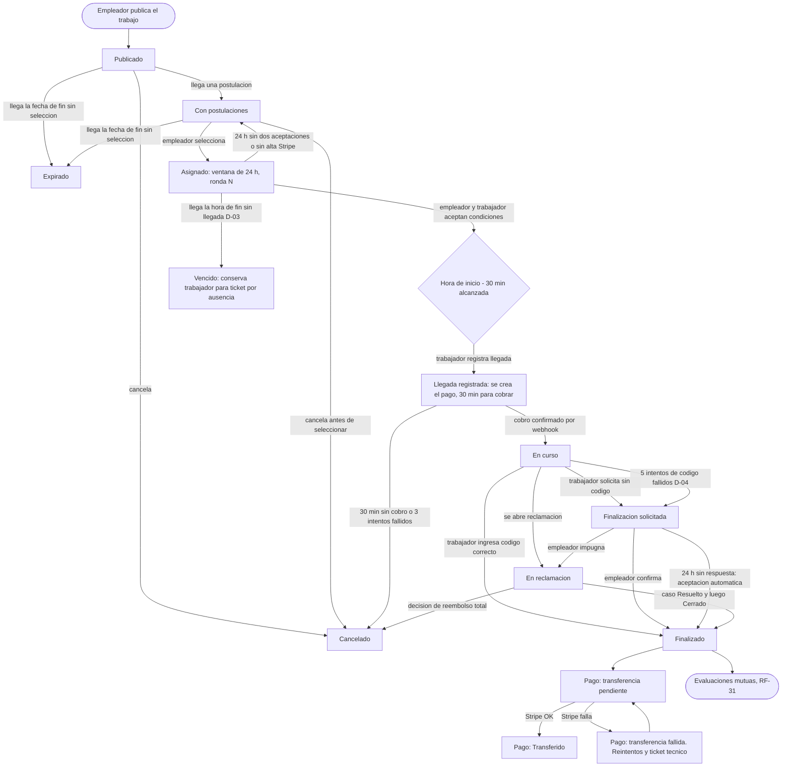
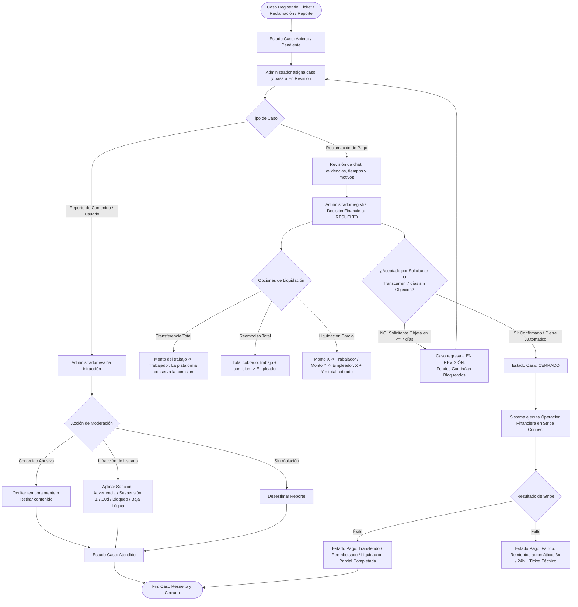
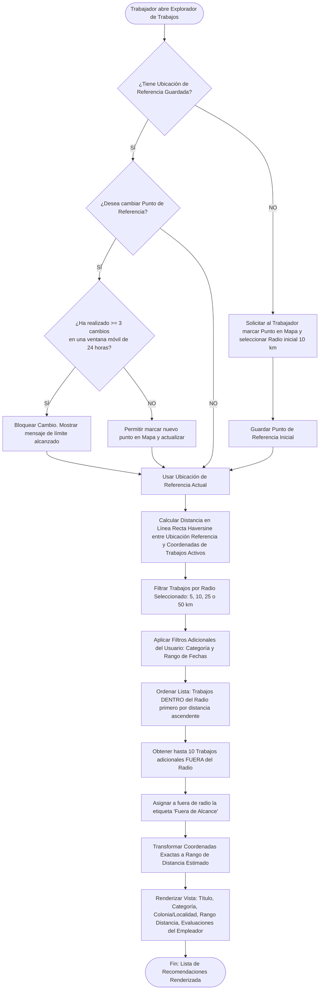
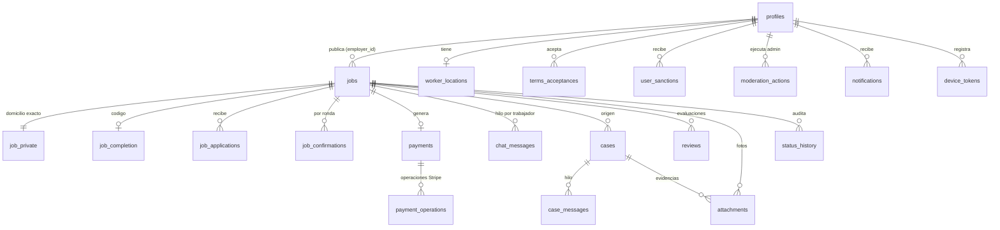

# Especificación de Arquitectura de Software y Diseño de Sistema

**Proyecto:** Sistema Multiplataforma para la Búsqueda y Contratación de Trabajos Temporales

**Versión del documento:** v2 (19/11/2026). Sustituye a la versión de Noviembre 2026 de Ezequiel.

**Versión de Referencia SRS:** v1.4 (18/11/2026), declarada final por Eber

**Archivo de base de datos asociado:** `001_trabajos_temporales.sql` (fuente única de verdad del esquema)

---

## ÍNDICE DE CONTENIDOS

0. [Decisiones de Eber y registro de cambios](#0-decisiones-de-eber-y-registro-de-cambios)
1. [Hito 1: Análisis del SRS e Identificación de Flujos Operativos por Rol](#1-hito-1-análisis-del-srs-e-identificación-de-flujos-operativos-por-rol)
2. [Hito 2: Diagramas de Flujo en Markdown / Mermaid](#2-hito-2-diagramas-de-flujo-en-markdown--mermaid)
3. [Hito 3: Identificación de Interfaces de Usuario (UI), Funciones y Datos Manejados](#3-hito-3-identificación-de-interfaces-de-usuario-ui-funciones-y-datos-manejados)
4. [Hito 4: Definición del Flujo de Navegación entre Interfaces (UI Flow)](#4-hito-4-definición-del-flujo-de-navegación-entre-interfaces-ui-flow)
5. [Hito 5: Modelo de Base de Datos PostgreSQL (modelo, seguridad y catálogo de RPC)](#5-hito-5-modelo-de-base-de-datos-postgresql-modelo-seguridad-y-catálogo-de-rpc)
6. [Pendientes, supuestos y riesgos](#6-pendientes-supuestos-y-riesgos)

---

## 0. Decisiones de Eber y registro de cambios

### 0.1 Decisiones confirmadas por Eber (19/11/2026)

El SRS v1.4 es final. Las dudas que surgieron se respondieron así; esta versión del documento y el SQL las aplican.

| ID | Tema | Decisión aplicada |
| :---- | :---- | :---- |
| D-01 | Reglas ya definidas en el SRS | Se aplica lo que dice el SRS (rangos de distancia, plazos, comisión). |
| D-02 | Reclamación: reparto de fondos | Transferencia total = importe del trabajo al trabajador (la plataforma conserva la comisión). Reembolso total = total cobrado. Parcial = transferencia + reembolso = total cobrado. Lo valida un trigger. |
| D-03 | Llega la hora de fin sin llegada del trabajador | El trabajo pasa a `expired` conservando al trabajador seleccionado, para permitir un ticket por ausencia. |
| D-04 | Código de finalización bloqueado (5 intentos) | El trabajador pasa a la ruta sin código (`completion_requested`). |
| D-05 a D-08 | Otras dudas de la lista | Se aplicó la propuesta del equipo en cada una; el detalle está en la respuesta original de Eber y en los comentarios del SQL. Este documento no los repite para no inventar el texto. |
| D-09 | Verificación | El correo se verifica con Supabase (límite de envíos reiniciado cada día). El teléfono no se verifica, solo se guarda en el perfil. |
| D-10 | Aviso de privacidad y términos | Los redacta el equipo desarrollador (texto pendiente, Lluvia). Se registra la aceptación con documento y versión. |
| D-11 | Prioridad | Prioridad media para los puntos marcados como tales en la lista de dudas. |

### 0.2 Qué cambió respecto a la versión anterior

| Área | Cambio |
| :---- | :---- |
| Seguridad | Los clientes solo leen tablas con RLS estricta. Toda escritura sensible pasa por funciones RPC. El domicilio y coordenadas exactas (`job_private`) y el código de finalización (`job_completion`) están en tablas aparte. El código solo lo lee el empleador; el trabajador lo valida con `verify_completion_code`. |
| Perfiles | `profiles` solo lo lee su dueño o un administrador. El contacto de la contraparte (teléfono) solo se obtiene con `get_counterpart_contact` cuando el trabajo ya está asignado. |
| Ciclo de vida | Se añadió la tabla `state_transitions` y un trigger que rechaza transiciones inválidas. `status_history` registra cada cambio. Se completó el Diagrama 2.1 (estaba vacío). |
| Rondas de selección | Al expirar una selección y elegir a otro trabajador, `selection_round` aísla confirmaciones, pagos y chat de la ronda anterior. |
| Pagos | Comisión y total generados en la base (redondeo a centavos, mitad hacia arriba). `payment_operations` con clave de idempotencia y `stripe_events` evitan cobros y webhooks duplicados. |
| Fechas | `start_at` y `end_at` generadas como `timestamptz` en la zona horaria del proyecto; se acabó comparar fecha y hora sueltas. |
| Ubicación del trabajador | Ventana móvil real de 24 h con `recent_changes`, no un contador. |
| Archivos | Tabla `attachments` (ruta, tipo MIME, tamaño) con límite de 5 por trabajo y tipo, o por caso, y 10 MB; reemplaza los arreglos de URL. |
| Casos | Una sola reclamación abierta por trabajo, destino del reporte tipificado (`target_type`, `target_id`), validación de montos de la decisión y tickets generados por el sistema (`reporter_id` nulo, `source = system`). |
| Integridad | `ON DELETE RESTRICT` en datos legales y financieros (sin cascadas); índices en todas las llaves foráneas; `moderation_status` (visible, hidden, removed). |
| Flujos y pantallas | 31 a 34 flujos y 33 a 35 pantallas (ver secciones 1 y 3). |
| Hito 5 | El DDL ya no se pega en este documento: vive en `001_trabajos_temporales.sql` y aquí se resume. Dos copias del mismo esquema se desincronizan. |

**Corrección al equipo:** un mensaje anterior decía que el trabajador seleccionado podía leer el código de finalización. Es incorrecto: solo el empleador lo lee.

---

## 1\. Hito 1: Análisis del SRS e Identificación de Flujos Operativos por Rol

Tras el análisis exhaustivo de los requerimientos funcionales (RF-01 a RF-33), restricciones y supuestos del SRS v1.4, se identifican un total de **34 Flujos Operativos Distintivos**, distribuidos entre los 3 roles principales del sistema (Empleador, Trabajador y Administrador).

### 1.1 Resumen Cuantitativo de Flujos por Rol

* **Rol Empleador (App Móvil):** 13 Flujos  
* **Rol Trabajador (App Móvil):** 13 Flujos  
* **Rol Administrador (Panel Web):** 8 Flujos  
* **TOTAL DE FLUJOS IDENTIFICADOS:** 34 Flujos

### 1.2 Matriz Detallada de Flujos por Rol

#### A. Flujos del Empleador (Aplicación Móvil React Native)

| ID Flujo | Nombre del Flujo | Requerimientos Asociados | Descripción Corta |
| :---- | :---- | :---- | :---- |
| **FL-EMP-01** | Registro y Autenticación de Empleador | RF-01, RF-02, RF-03, RF-33, S2 | Registro con correo/teléfono, validación de fecha de nacimiento (\>=18 años) y aceptación de términos/privacidad. |
| **FL-EMP-02** | Gestión de Perfil de Empleador | RF-04 | Edición de nombre/razón comercial, teléfono de contacto y foto de perfil opcional. |
| **FL-EMP-03** | Publicación de Trabajo Temporal | RF-05, S3, S4, S8 | Registro de título, descripción, categoría, pago (min \$10 MXN), fecha, hora, condiciones, colonia y ubicación exacta en mapa (hasta 5 fotos). El domicilio y las coordenadas exactas se guardan aparte (`job_private`). |
| **FL-EMP-04** | Edición y Cancelación Pre-Selección | RF-06 | Modificación de datos de la publicación o cancelación directa antes de seleccionar candidato. |
| **FL-EMP-05** | Revisión y Selección de Postulante | RF-12, S7 | Inspección de perfiles de postulantes (evaluaciones, habilidades, foto) y selección de candidato (inicia ventana de 24h). |
| **FL-EMP-06** | Aceptación de Condiciones | RF-16 | Confirmación explícita del botón "Acepto las condiciones" post-selección. |
| **FL-EMP-07** | Pago en Escrow (Stripe Connect) | RF-15, RF-16, RF-17, RF-18, S9 | Pago del importe total (Trabajo \+ 10% comisión) tras el registro de llegada del trabajador dentro del límite de 30 min. |
| **FL-EMP-08** | Comunicación por Chat en Tiempo Real | RF-14 | Intercambio de mensajes de texto con el trabajador seleccionado durante la vigencia del trabajo. |
| **FL-EMP-09** | Confirmación / Impugnación de Finalización | RF-21, RF-22, RF-23, RF-24 | Compartir código de 6 dígitos (solo el empleador puede leerlo) o responder a solicitud sin código dentro de 24h (impugnar abre Reclamación/Ticket). Sin respuesta en 24h, aceptación automática. |
| **FL-EMP-10** | Apertura de Reclamación, Reporte o Ticket | RF-13, RF-25, RF-26, RF-27, RF-28 | Creación de casos por ausencia, cancelación justificada o reportes de usuario/mensaje. |
| **FL-EMP-11** | Evaluación y Reseña del Trabajador | RF-31 | Calificación con 1 a 5 estrellas y reseña en texto tras el cierre exitoso del trabajo. |
| **FL-EMP-12** | Rechazo de Postulación *(propuesta, confirmar con Eber)* | RF-11, RF-12 | Descartar una postulación pendiente sin seleccionarla (estado Rechazada). Hoy el SRS define el estado pero no la acción del empleador. |
| **FL-EMP-13** | Mis Casos y Tickets | RF-25, RF-28 | Consulta del estado y las respuestas de los casos propios (el SRS exige que el solicitante pueda objetar la resolución en 7 días). |

#### B. Flujos del Trabajador (Aplicación Móvil React Native)

| ID Flujo | Nombre del Flujo | Requerimientos Asociados | Descripción Corta |
| :---- | :---- | :---- | :---- |
| **FL-TRAB-01** | Registro y Autenticación de Trabajador | RF-01, RF-02, RF-03, RF-33, S2 | Registro de usuario, verificación de edad y aceptación obligatoria de términos y aviso de privacidad. |
| **FL-TRAB-02** | Gestión de Perfil de Trabajador | RF-04 | Edición de habilidades (máx 300 chars), disponibilidad, foto de perfil y teléfono. |
| **FL-TRAB-03** | Configuración de Ubicación de Referencia | RF-08, S5 | Marcado manual de punto en mapa y radio (5, 10, 25, 50 km). Máximo 3 cambios en una ventana móvil de 24 horas. Sin permisos GPS. |
| **FL-TRAB-04** | Búsqueda y Filtrado de Trabajos | RF-07, RF-09, RF-10, S6, S8 | Consulta de trabajos en orden por distancia. Muestra colonia y rango de distancia. Máx 10 fuera de alcance. |
| **FL-TRAB-05** | Postulación a Trabajos | RF-11 | Postulación única a trabajo disponible y consulta de estados (Pendiente, Aceptada, Rechazada, Retirada, Expirada). |
| **FL-TRAB-06** | Onboarding / Alta Stripe Connect | RF-12, RF-19 | Vinculación y validación de cuenta conectada de Stripe tras ser seleccionado (plazo máximo 24h). |
| **FL-TRAB-07** | Aceptación de Condiciones de Trabajo | RF-16 | Confirmación de condiciones asignadas dentro de la ventana de 24 horas. |
| **FL-TRAB-08** | Registro de Llegada al Lugar | RF-16 | Marcado de llegada desde 30 min antes de la hora de inicio (desbloquea el cobro al empleador). |
| **FL-TRAB-09** | Chat en Tiempo Real con Empleador | RF-14 | Comunicación directa con el empleador tras la selección. |
| **FL-TRAB-10** | Solicitud de Finalización de Trabajo | RF-21, RF-22, RF-23 | Finalización por ingreso de código de 6 dígitos o solicitud sin código adjuntando evidencias (hasta 5 archivos JPG/PNG/PDF). |
| **FL-TRAB-11** | Apertura y Respuesta a Casos / Reclamaciones | RF-25, RF-26, RF-28, RF-29 | Gestión de tickets, disputas de pago no procesado o reportes. |
| **FL-TRAB-12** | Evaluación y Reseña del Empleador | RF-31 | Calificación de 1 a 5 estrellas al empleador tras concluir el trabajo. |
| **FL-TRAB-13** | Notificaciones | RF-32 | Bandeja de avisos (selección, plazos, pago, casos) y registro del token de dispositivo para push. |

#### C. Flujos del Administrador (Panel Web React \+ Vite)

| ID Flujo | Nombre del Flujo | Requerimientos Asociados | Descripción Corta |
| :---- | :---- | :---- | :---- |
| **FL-ADM-01** | Autenticación Segura de Administrador | RF-02, S1 | Inicio de sesión en panel web para cuentas administrativas creadas por el equipo desarrollador. |
| **FL-ADM-02** | Gestión Integrada de Casos (Bandeja) | RF-25 | Navegación y filtrado de casos (Tickets, Reclamaciones y Reportes). Control de estados Abierto/En revisión/Resuelto/Cerrado. |
| **FL-ADM-03** | Resolución y Arbitraje de Reclamaciones | RF-17, RF-18, RF-20, RF-25, RF-26 | Asignación de decisión sobre fondos retenidos: Transferencia total, Reembolso total o Liquidación parcial (ejecución única al Cerrar caso). |
| **FL-ADM-04** | Moderación de Contenidos | RF-29, S11 | Ocultamiento temporal o retiro definitivo de publicaciones, reseñas, comentarios o mensajes abusivos. |
| **FL-ADM-05** | Aplicación de Sanciones a Cuentas | RF-29, RF-30 | Envío de advertencias, suspensión por 1/7/30 días o bloqueo permanente de cuentas infractoras. |
| **FL-ADM-06** | Ejecución de Baja Lógica de Usuario | RF-30 | Desactivación de cuentas (impide login y oculta perfil), preservando registros históricos financieros y legales. |
| **FL-ADM-07** | Atención de Tickets de Soporte e Incidencias | RF-25, RF-28 | Respuesta y resolución de tickets técnicos, fallos de transferencia de Stripe y consultas operativas. |
| **FL-ADM-08** | Gestión de Reintentos Financieros | RF-18, RF-20 | Monitoreo y reintento manual/automático de transferencias o liquidaciones parciales fallidas. |

---


## 2\. Hito 2: Diagramas de Flujo en Markdown / Mermaid

### 2.1 Diagrama del Ciclo de Vida del Trabajo y Procesamiento de Pago (Flujo Principal)

Cada flecha de este diagrama corresponde a una fila de `state_transitions` (sección 5.5); la base de datos rechaza cualquier transición que no esté en esa tabla. Los nombres de estado en inglés están en el catálogo de la sección 5.5.



### 2.2 Diagrama del Módulo de Casos, Arbitraje de Pagos y Sanciones (Administrador)



### 2.3 Diagrama del Algoritmo de Búsqueda y Ubicación por Radio del Trabajador



---


## 3\. Hito 3: Identificación de Interfaces de Usuario (UI), Funciones y Datos Manejados

A continuación se presenta el desglose detallado de las **35 pantallas mínimas indispensables** del sistema. Para cada interfaz se listan las funciones en formato de viñetas (*bullets*) y se especifica en detalle el conjunto de datos de entrada, salida, persistencia y estado que maneja cada una.

### 3.1 Aplicación Web Administrador (React 18 \+ Vite \+ Tailwind CSS) — 7 Pantallas Mínimas

| Código UI | Nombre de Pantalla | Funciones Correspondientes (Bulleted) | Detalle de Datos Manejados |
| :---- | :---- | :---- | :---- |
| **UI-ADM-01** | *Login Administrador* | • Autenticar identidad de administradores previa invitación.<br/>• Gestionar sesiones seguras JWT mediante Supabase Auth.<br/>• Solicitar restablecimiento de contraseña administrativa. | **Entradas:** Email corporativo, contraseña (min 8 chars), token de restablecimiento.<br/>**Salidas/Estado:** JWT Token de sesión activa con rol `admin`, mensaje de error si no es cuenta invitada. |
| **UI-ADM-02** | *Dashboard / Bandeja de Casos* | • Listar casos unificados (Tickets, Reclamaciones, Reportes).<br/>• Filtrar casos por tipo, estado y fecha (el SRS no define prioridad).<br/>• Asignar casos a administradores activos.<br/>• Monitorear contadores globales del sistema. | **Datos de Entrada/Filtro:** `case_type`, `status` (`open`, `in_review`, `resolved`, `closed`), rango de fechas, ID de admin asignado.<br/>**Datos de Salida:** Lista con `case_id`, `reporter_name`, `created_at`, badges de tipo y estado, contador de casos pendientes. |
| **UI-ADM-03** | *Detalle y Arbitraje de Reclamación* | • Inspeccionar historial completo de un trabajo en disputa.<br/>• Consultar evidencias multimedia adjuntas.<br/>• Leer transacciones financieras en Escrow de Stripe Connect.<br/>• Emitir resolución de arbitraje (Total o Parcial).<br/>• Controlar la ventana de objeción de 7 días. | **Datos Consultados:** Historial de trabajo, historial de chat (`chat_messages`), adjuntos de la tabla `attachments` (hasta 5 por caso, JPG/PNG/PDF \<= 10 MB), `stripe_payment_intent_id`, `total_charged_mxn`.<br/>**Datos Registrados:** `resolution_notes`, `approved_transfer_amount`, `approved_refund_amount`, `assigned_admin_id`, `auto_close_deadline` (resolución + 7 días). |
| **UI-ADM-04** | *Atención de Tickets y Soporte* | • Búsqueda y filtrado de tickets de soporte.<br/>• Intercambiar respuestas en hilo de texto con el usuario.<br/>• Transicionar el estado del ticket (Abierto → En revisión → Resuelto → Cerrado). | **Datos Consultados:** `ticket_id`, `reporter_id`, `ticket_category` (`account`, `publication`, `application`, `job`, `payment`, `technical`), mensaje inicial.<br/>**Datos Generados:** Texto de respuesta administrativa, cambios de `status`, fecha/hora de actualización. |
| **UI-ADM-05** | *Centro de Moderación de Contenido* | • Inspeccionar elementos reportados por usuarios.<br/>• Ejecutar acción de ocultar contenido (deshabilitar visibilidad temporal).<br/>• Ejecutar acción de retirar contenido (eliminación de vista pública).<br/>• Registrar bitácora de decisión de moderación. | **Datos Manejados:** ID del elemento reportado (`job_id`, `review_id`, `chat_message_id`), contenido textual u fotos asociadas, motivo del reporte.<br/>**Datos de Salida:** Flags booleanos `is_hidden` o marca de retiro definitivo, registro en bitácora administrativa con `admin_id` y fecha. |
| **UI-ADM-06** | *Gestión y Sanción de Cuentas* | • Buscar perfiles de usuario por nombre, correo o ID.<br/>• Emitir advertencias por incumplimiento de normas.<br/>• Aplicar suspensiones temporales (1, 7 o 30 días).<br/>• Aplicar bloqueo permanente de cuenta.<br/>• Ejecutar baja lógica conservando registros legales.<br/>• Gestionar apelaciones ingresadas por usuarios. | **Datos de Usuario Consultados:** `user_id`, `full_name`, `email`, `role`, `account_status`, historial de trabajos/reportes.<br/>**Datos de Sanción Ingresados:** `sanction_type` (`warning`, `suspension_1d`, `suspension_7d`, `suspension_30d`, `permanent_block`, `soft_delete`), `reason`, `suspended_until` (timestamp). |
| **UI-ADM-07** | *Monitoreo Financiero y Reintentos Stripe* | • Auditar log de webhooks recibidos y firmados de Stripe.<br/>• Visualizar estados de pagos en tiempo real.<br/>• Ejecutar reintentos manuales de transferencias o reembolsos fallidos. | **Datos Consultados:** Log de webhooks (`stripe_event_id`, firma de verificación, payload JSON), `payment_status`, `payment_attempts`.<br/>**Datos de Control:** Disparador de reintento (`retry_trigger`), registros de logs de error de API de Stripe. |

---

### 3.2 Aplicación Móvil Empleador (React Native \+ Android 10+) — 14 Pantallas Mínimas

| Código UI | Nombre de Pantalla | Funciones Correspondientes (Bulleted) | Detalle de Datos Manejados |
| :---- | :---- | :---- | :---- |
| **UI-EMP-01** | *Auth & Onboarding Empleador* | • Registrar nueva cuenta con correo, contraseña y teléfono.<br/>• Iniciar y cerrar sesión.<br/>• Restablecer contraseña olvidada.<br/>• Declarar fecha de nacimiento para verificar mayoría de edad (\>= 18 años).<br/>• Consultar y aceptar Términos de Uso y Aviso de Privacidad.<br/>• Pantalla "Revisa tu correo" para la verificación de correo (D-09). | **Entradas:** `email`, `password` (política: \>=8 chars, 1 mayúscula, 1 minúscula, 1 número), `phone`, `birth_date`.<br/>**Salidas/Estado:** ID de usuario autenticado en Supabase Auth, registro en `terms_acceptances` (documento, versión, fecha). El teléfono solo se registra en el perfil, no se verifica (D-09). El perfil se crea con `complete_profile`. |
| **UI-EMP-02** | *Feed / Mis Publicaciones* | • Desplegar catálogo de trabajos creados organizados por estado.<br/>• Filtrar publicaciones por estado (Publicado, Asignado, En Curso, Finalizado, Cancelado).<br/>• Acceso directo al formulario de creación. | **Datos Consultados:** Lista de publicaciones pertenecientes al `employer_id` con `job_id`, `title`, `category`, `fixed_payment_mxn`, `job_date`, `status`, y conteo de postulaciones recibidas. |
| **UI-EMP-03** | *Formulario de Publicación / Edición* | • Capturar datos generales del empleo temporal.<br/>• Seleccionar ubicación mediante marcado de pin en mapa.<br/>• Adjuntar hasta 5 fotografías explicativas.<br/>• Validar pago mínimo en MXN (\$10.00 MXN o mínimo de Stripe).<br/>• Guardar o actualizar la publicación. | **Entradas de Formulario:** `title`, `description`, `category` (`limpieza`, `pintura`, `jardineria`, `mudanzas`, `eventos`, `otros`), `fixed_payment_mxn`, `job_date`, `start_time`, `end_time`, `conditions`.<br/>**Datos de Ubicación:** `neighborhood` (texto colonia), `exact_address` (domicilio/referencia), `exact_latitude`, `exact_longitude`.<br/>**Archivos:** hasta 5 fotos JPG/PNG de máx 10 MB, guardadas en Storage y registradas en `attachments` (`kind = job_photo`). El domicilio y las coordenadas se guardan en `job_private`. |
| **UI-EMP-04** | *Detalle de Publicación y Postulantes* | • Ver información completa de la publicación activa.<br/>• Listar candidatos postulados.<br/>• Editar datos de la publicación (si no hay candidato seleccionado).<br/>• Cancelar publicación directamente (pre-selección). | **Datos Consultados:** Atributos del trabajo, arreglo de postulaciones con `application_id`, `worker_id`, `created_at`, `status`.<br/>**Acciones:** Modificación de campos o cambio de estado del trabajo a `cancelled`. |
| **UI-EMP-05** | *Perfil del Candidato Postulado* | • Revisar perfil público del trabajador postulado.<br/>• Consultar promedio de evaluaciones y reseñas previas.<br/>• Visualizar habilidades y disponibilidad.<br/>• Seleccionar candidato para el trabajo (inicia reloj de 24h). | **Datos Mostrados del Trabajador:** `full_name`, `photo_url`, `skills` (máx 300 chars), `availability` (máx 300 chars), promedio de estrellas y lista de `reviews`. (Oculta teléfono y ubicación exacta).<br/>**Acciones de Selección:** Asignación de `selected_worker_id`, generación de `selection_expires_at` (now \+ 24 horas) y actualización del trabajo a `assigned`. |
| **UI-EMP-06** | *Detalle de Trabajo Asignado* | • Mostrar temporizador regresivo del plazo de 24 horas.<br/>• Confirmar de forma explícita las condiciones del trabajo.<br/>• Visualizar datos de contacto directo del trabajador una vez desbloqueados. | **Datos Manejados:** Contador de tiempo restante de `selection_expires_at`, visualización del `phone` del trabajador.<br/>**Acción de Entrada:** Registro de confirmación en `job_confirmations` con `user_id` y `confirmed_at`. |
| **UI-EMP-07** | *Checkout y Confirmación de Pago* | • Desglosar desglose financiero (Pago del trabajo \+ 10% Comisión \= Total MXN).<br/>• Procesar cobro seguro en Stripe Connect mediante SDK.<br/>• Recibir notificación del estado de la transacción. | **Datos de Salida/Cobro:** `job_amount_mxn`, `platform_fee_mxn` (redondeado a centavos), `total_charged_mxn`.<br/>**Entradas de Stripe:** Datos de tarjeta de crédito/débito capturados en el SDK nativo, emisión de `stripe_payment_intent_id`. |
| **UI-EMP-08** | *Chat en Tiempo Real* | • Enviar y recibir mensajes de texto en tiempo real.<br/>• Reportar mensajes individuales por contenido inapropiado. | **Datos Transaccionados:** `job_id`, `sender_id`, `message_text`, `created_at` entregados mediante Supabase Realtime.<br/>**Acción de Reporte:** Generación de un caso tipo `report` asociado al `message_id`. |
| **UI-EMP-09** | *Módulo de Finalización de Trabajo* | • Generar y consultar código de 6 dígitos para compartir al trabajador.<br/>• Recibir y responder solicitud de finalización sin código.<br/>• Confirmar o impugnar finalización dentro de 24 horas. | **Datos de Código:** `job_completion.code` (6 dígitos; solo lo puede leer el empleador) y `code_expires_at` (24 h).<br/>**Datos de Solicitud sin Código:** adjuntos del trabajador (`attachments`).<br/>**Respuesta:** Confirmación (pasa trabajo a `completed`) o Impugnación (abre `claim` o `ticket`). |
| **UI-EMP-10** | *Formulario de Apertura de Casos* | • Crear tickets de soporte o reclamaciones de pago por cancelaciones/ausencias.<br/>• Cargar evidencias que respalden la solicitud. | **Entradas de Formulario:** `case_type` (`ticket` o `claim`), `ticket_category` (`job`, `payment`, etc.), `description`, adjuntos de la tabla `attachments` (hasta 5 por caso, JPG/PNG/PDF \<= 10 MB). |
| **UI-EMP-11** | *Evaluación y Calificación* | • Asignar calificación de 1 a 5 estrellas al trabajador.<br/>• Escribir comentario descriptivo sobre el trabajo finalizado. | **Entradas:** `rating` (entero del 1 al 5), `comment` (texto), `job_id`, `reviewee_id` (ID del trabajador). |
| **UI-EMP-12** | *Historial de Trabajos y Pagos* | • Consultar registro histórico de trabajos creados.<br/>• Inspeccionar estados de pagos, reembolsos y comprobantes. | **Datos de Salida:** Lista histórica con `job_id`, `title`, `fixed_payment_mxn`, `total_charged_mxn`, `payment_status`, fecha de realización. |
| **UI-EMP-13** | *Perfil y Ajustes de Empleador* | • Editar nombre o razón comercial.<br/>• Editar teléfono de contacto.<br/>• Actualizar foto de perfil.<br/>• Consultar documentos legales y cerrar sesión. | **Entradas de Edición:** `full_name`, `phone`, `photo_url` (JPG/PNG \<= 10MB).<br/>**Estado:** Limpieza de Tokens al cerrar sesión. |
| **UI-EMP-14** | *Mis Casos y Tickets* | • Listar casos propios con su estado.<br/>• Leer y responder en el hilo del caso.<br/>• Objetar una resolución dentro de los 7 días. | **Datos Consultados:** `cases` y `case_messages` de los que el usuario es parte (RLS).<br/>**Acciones:** respuesta en el hilo, objeción de resolución. Pendiente de implementar: RPC `object_case`. |

---

### 3.3 Aplicación Móvil Trabajador (React Native \+ Android 10+) — 14 Pantallas Mínimas

| Código UI | Nombre de Pantalla | Funciones Correspondientes (Bulleted) | Detalle de Datos Manejados |
| :---- | :---- | :---- | :---- |
| **UI-TRAB-01** | *Auth & Onboarding Trabajador* | • Registro de cuenta con correo, contraseña y teléfono.<br/>• Inicio y cierre de sesión.<br/>• Restablecimiento de contraseña.<br/>• Declaración de fecha de nacimiento (verificación \>= 18 años).<br/>• Aceptación obligatoria de términos legales.<br/>• Pantalla "Revisa tu correo" para la verificación de correo (D-09). | **Entradas:** `email`, `password`, `phone`, `birth_date`.<br/>**Salidas/Estado:** Token JWT autenticado, registro en `terms_acceptances` vía `accept_terms`. El perfil se crea con `complete_profile`. |
| **UI-TRAB-02** | *Explorador y Lista de Trabajos* | • Consultar lista de trabajos ordenados por distancia desde la ubicación de referencia.<br/>• Filtrar por categoría y rango de fechas.<br/>• Visualizar tarjetas de trabajos con colonia y rango de distancia estimado.<br/>• Identificar hasta 10 trabajos etiquetados como "Fuera de alcance". | **Datos Mostrados:** `title`, `category`, `fixed_payment_mxn`, `job_date`, `neighborhood`, etiqueta de rango (`menos de 5 km`, `5 a menos de 10 km`, `10 a menos de 25 km`, `25 a 50 km`, `más de 50 km`), `employer_name`, promedio de evaluaciones del empleador.<br/>**Filtros:** `category`, `start_date`, `end_date`. |
| **UI-TRAB-03** | *Configuración de Ubicación y Radio* | • Seleccionar y guardar manualmente un punto de referencia en el mapa (sin GPS).<br/>• Seleccionar radio de búsqueda (5, 10, 25, 50 km; valor por defecto 10 km).<br/>• Controlar el límite de máximo 3 cambios de ubicación en un periodo de 24 horas. | **Entradas de Ubicación:** `latitude`, `longitude`, `search_radius_km`.<br/>**Datos de Control:** `recent_changes` (marcas de tiempo de los cambios de las últimas 24 h; límite de 3 aplicado dentro de `save_worker_location`). |
| **UI-TRAB-04** | *Detalle de Oportunidad de Trabajo* | • Consultar la descripción completa del empleo pre-selección.<br/>• Ver evaluaciones previas del empleador (o el texto "Sin evaluaciones").<br/>• Postularse al trabajo seleccionado (postulación única). | **Datos Mostrados:** `title`, `description`, `fixed_payment_mxn`, `job_date`, `start_time`, `end_time`, `conditions`, `neighborhood`, rango de distancia, `employer_name`, evaluaciones.<br/>**Acción:** Registro de postulación en `job_applications` con `job_id`, `worker_id` y `status = 'pending'`. |
| **UI-TRAB-05** | *Mis Postulaciones* | • Consultar lista de postulaciones activas e históricas.<br/>• Visualizar estado de postulación (Pendiente, Aceptada, Rechazada, Retirada, Expirada).<br/>• Retirar una postulación que se encuentre en estado Pendiente. | **Datos Mostrados:** Lista con `job_title`, `created_at`, `status`.<br/>**Acción de Salida:** Actualización de `status` a `withdrawn`. |
| **UI-TRAB-06** | *Onboarding Stripe Connect* | • Iniciar vinculación con Stripe Connect para cobros de trabajos.<br/>• Redirigir a flujo alojado por Stripe para datos bancarios e identidad.<br/>• Consultar el estado de verificación del alta de la cuenta conectada. | **Datos de Enlace:** `stripe_account_id`.<br/>**Datos Recibidos de Webhook:** `stripe_onboarding_complete` (booleano). No se almacenan datos bancarios ni documentos de identidad en Supabase; solo el `stripe_account_id` y la bandera de alta completa. |
| **UI-TRAB-07** | *Detalle de Trabajo Asignado / Llegada* | • Consultar dirección exacta y punto exacto en el mapa (desbloqueados tras ser seleccionado).<br/>• Confirmar de forma explícita las condiciones del trabajo.<br/>• Marcar registro de llegada al lugar del trabajo. | **Datos Desbloqueados:** `exact_address`, `exact_latitude`, `exact_longitude`, `employer_phone`.<br/>**Acción de Llegada:** Cambio de estado del trabajo a `arrival_registered` (disponible desde 30m antes de `start_time` hasta `end_time`). |
| **UI-TRAB-08** | *Chat en Tiempo Real* | • Intercambiar mensajes de texto con el empleador.<br/>• Reportar mensajes abusivos. | **Datos Transaccionados:** Mensajes de texto en tiempo real vía Supabase Realtime.<br/>**Acción de Reporte:** Creación de caso de moderación por mensaje reportado. |
| **UI-TRAB-09** | *Pantalla de Finalización de Trabajo* | • Opción A: Ingresar código numérico de 6 dígitos recibido del empleador.<br/>• Opción B: Solicitar finalización sin código adjuntando evidencias opcionales.<br/>• Solicitar código de reemplazo en caso de vencimiento del primero. | **Método A (Código):** el trabajador no puede leer el código; lo valida con `verify_completion_code(job, code)`, que responde `ok`, `invalid`, `blocked` o `expired` (máx 5 intentos).<br/>**Método B (Sin Código):** adjunta hasta 5 archivos en `attachments` (JPG/PNG/PDF \<= 10 MB c/u) y llama `request_completion`, que pasa el trabajo a `completion_requested`. |
| **UI-TRAB-10** | *Centro de Casos y Soporte* | • Crear tickets de soporte o reclamaciones de pago.<br/>• Consultar e interactuar en el historial de casos propios. | **Entradas:** `case_type`, `ticket_category`, `description`, adjuntos en `attachments`.<br/>**Datos de Salida:** Estado del caso, resoluciones y respuestas de la administración. |
| **UI-TRAB-11** | *Evaluación del Empleador* | • Calificar al empleador con 1 a 5 estrellas.<br/>• Escribir una reseña sobre el trato y condiciones de la contratación. | **Entradas:** `rating` (1 a 5), `comment` (texto libre), `job_id`, `reviewee_id` (ID del empleador). |
| **UI-TRAB-12** | *Perfil de Trabajador* | • Editar habilidades personales (máx 300 caracteres).<br/>• Editar disponibilidad de tiempo (máx 300 caracteres).<br/>• Actualizar teléfono de contacto y foto de perfil. | **Entradas:** `skills`, `availability`, `phone`, `photo_url` (JPG/PNG \<= 10MB). |
| **UI-TRAB-13** | *Historial de Trabajos y Pagos* | • Consultar historial de trabajos concluidos exitosamente.<br/>• Consultar registros de transferencias recibidas en la cuenta de Stripe Connect. | **Datos Consultados:** Lista de trabajos finalizados, montos de transferencia abonados, `stripe_transfer_id`, historial de ganancias netas. |
| **UI-TRAB-14** | *Notificaciones* | • Listar avisos del sistema (selección, plazos, pago, casos).<br/>• Marcar avisos como leídos.<br/>• Registrar el token de dispositivo para push. | **Datos Consultados:** `notifications` del usuario (RLS) y registro en `device_tokens`.<br/>**Acciones:** marcar `read_at`. El envío del push es una Edge Function pendiente. |

---


## 4\. Hito 4: Definición del Flujo de Navegación entre Interfaces (UI Flow)

Las notificaciones push abren directamente la pantalla relacionada (trabajo asignado, checkout, caso). En la app del empleador la pantalla de notificaciones reutiliza el mismo componente que UI-TRAB-14 (sugerencia mía; el SRS no la lista como pantalla separada).

### 4.1 Diagrama de Navegación — App Móvil Empleador

```
[UI-EMP-01: Auth / Registro / Revisa tu correo]
       │
       ├──> [UI-EMP-02: Feed / Mis Publicaciones] <─────────────────────────────┐
       │         │                                                              │
       │         ├──> [UI-EMP-03: Crear / Editar Trabajo]                       │
       │         │                                                              │
       │         ├──> [UI-EMP-04: Detalle Publicación / Postulantes]            │
       │         │         │                                                    │
       │         │         └──> [UI-EMP-05: Perfil Candidato] ──(Seleccionar)───┤
       │         │                                                              │
       │         ├──> [UI-EMP-06: Trabajo Asignado & Condiciones]               │
       │         │         │                                                    │
       │         │         ├──> [UI-EMP-07: Checkout Stripe (Cobro)]            │
       │         │         │                                                    │
       │         │         ├──> [UI-EMP-08: Chat en Tiempo Real]                │
       │         │         │                                                    │
       │         │         └──> [UI-EMP-09: Verificación Finalización/Código]  │
       │         │                   │                                          │
       │         │                   └──> [UI-EMP-11: Evaluación y Reseña] ─────┤
       │         │                                                              │
       │         ├──> [UI-EMP-10: Formulario Apertura de Casos]                 │
       │         │         └──> [UI-EMP-14: Mis Casos y Tickets]                │
       │         │                                                              │
       │         ├──> [UI-EMP-12: Historial Trabajos y Pagos]                   │
       │         │                                                              │
       │         └──> [UI-EMP-13: Perfil y Ajustes]                             │
```

### 4.2 Diagrama de Navegación — App Móvil Trabajador

```
[UI-TRAB-01: Auth / Registro / Revisa tu correo]
       │
       ├──> [UI-TRAB-02: Explorador de Trabajos] <──────────────────────────────┐
       │         │                                                              │
       │         ├──> [UI-TRAB-03: Ubicación Referencia y Radio Mapa]           │
       │         │                                                              │
       │         ├──> [UI-TRAB-04: Detalle Oportunidad] ──(Postularse)──┐        │
       │         │                                                      │        │
       │         ├──> [UI-TRAB-05: Mis Postulaciones] <─────────────────┘        │
       │         │         │                                                     │
       │         │         └──> [UI-TRAB-06: Onboarding Stripe Connect]          │
       │         │                                                              │
       │         ├──> [UI-TRAB-07: Trabajo Asignado & Registrar Llegada]         │
       │         │         │                                                     │
       │         │         ├──> [UI-TRAB-08: Chat en Tiempo Real]                 │
       │         │         │                                                     │
       │         │         └──> [UI-TRAB-09: Finalizar Trabajo (Código/Evid)]   │
       │         │                   │                                           │
       │         │                   └──> [UI-TRAB-11: Evaluación Empleador] ────┤
       │         │                                                               │
       │         ├──> [UI-TRAB-10: Centro de Casos y Soporte]                    │
       │         │                                                               │
       │         ├──> [UI-TRAB-14: Notificaciones]                               │
       │         │                                                               │
       │         ├──> [UI-TRAB-13: Historial Trabajos y Pagos]                    │
       │         │                                                               │
       │         └──> [UI-TRAB-12: Perfil de Trabajador]                        │
```

### 4.3 Diagrama de Navegación — Panel Web Administrador

```
[UI-ADM-01: Login Admin]
       │
       └──> [UI-ADM-02: Dashboard / Bandeja de Casos]
                 │
                 ├──> [UI-ADM-03: Detalle y Arbitraje de Reclamaciones]
                 │
                 ├──> [UI-ADM-04: Atención de Tickets de Soporte]
                 │
                 ├──> [UI-ADM-05: Centro de Moderación de Contenido]
                 │
                 ├──> [UI-ADM-06: Gestión y Sanción de Cuentas]
                 │
                 └──> [UI-ADM-07: Monitoreo Financiero y Reintentos Stripe]
```

---


## 5\. Hito 5: Modelo de Base de Datos PostgreSQL (modelo, seguridad y catálogo de RPC)

El esquema completo está en `001_trabajos_temporales.sql` (PostgreSQL 15+, Supabase). Ese archivo es la única fuente de verdad: el ERD de abajo es un resumen y los tipos de TypeScript deben generarse con `supabase gen types`, no copiarse a mano. La migración se probó en PGlite (Postgres compilado a WASM) con 108 comprobaciones; ver la sección 6 para lo que esa prueba no cubre.

### 5.1 Principios de diseño

* Un cliente (`authenticated`) solo hace `SELECT`, y solo sobre lo que su RLS permite. No tiene `INSERT`, `UPDATE` ni `DELETE` directos, salvo chat, adjuntos, tokens de dispositivo y marcar notificaciones como leídas.
* Toda escritura sensible es una función RPC `SECURITY DEFINER` que valida rol, estado, plazos y usa la hora del servidor.
* Lo privado va separado: `job_private` (domicilio y coordenadas), `job_completion` (código), teléfono solo vía `get_counterpart_contact`.
* Las transiciones de estado se validan en la base con `state_transitions` y un trigger.
* Las funciones de servicio (`service_confirm_payment`, `expire_overdue`) solo las ejecuta `service_role` (Edge Functions y `pg_cron`).

### 5.2 Modelo entidad-relación (resumen)



Tablas (22): `profiles`, `terms_acceptances`, `worker_locations`, `jobs`, `job_private`, `job_completion`, `job_applications`, `job_confirmations`, `payments`, `payment_operations`, `stripe_events`, `chat_messages`, `cases`, `case_messages`, `reviews`, `user_sanctions`, `moderation_actions`, `attachments`, `notifications`, `device_tokens`, `status_history`, `state_transitions`.

### 5.3 Matriz de acceso (RLS y permisos)

| Tabla | Quién lee | Escritura directa del cliente |
| :---- | :---- | :---- |
| `profiles` | Su dueño y administradores. Otros perfiles solo vía RPC (`get_applicants`, `get_counterpart_contact`). | Dueño: nombre, teléfono, foto, habilidades, disponibilidad |
| `terms_acceptances` | Su dueño y administradores | Ninguna (`accept_terms`) |
| `worker_locations` | Su dueño | Ninguna (`save_worker_location`) |
| `jobs` | Empleador dueño; trabajador postulado o seleccionado; administrador. Los demás usan `search_jobs` / `get_job_public`. | Ninguna |
| `job_private` | Empleador dueño; trabajador seleccionado; administrador | Ninguna |
| `job_completion` | Solo el empleador dueño del trabajo (ni el trabajador ni el administrador) | Ninguna |
| `job_applications` | Trabajador dueño de la postulación; empleador del trabajo; administrador | Ninguna |
| `job_confirmations` | Empleador, trabajador seleccionado y administrador (cada fila lleva su ronda) | Ninguna |
| `payments`, `payment_operations` | Partes del trabajo; administrador | Ninguna |
| `stripe_events` | Solo administrador | Ninguna |
| `chat_messages` | Empleador y trabajador seleccionado del hilo; administrador que atiende | INSERT propio (sender = usuario, hilo vigente); sin UPDATE ni DELETE |
| `cases`, `case_messages` | Partes del caso; administrador | Ninguna |
| `reviews` | Cualquier usuario autenticado ve las visibles; el autor y el administrador ven también las ocultas | Ninguna |
| `user_sanctions` | El sancionado ve las suyas y el administrador todas | Ninguna |
| `moderation_actions` | Solo administrador | Ninguna |
| `attachments` | Partes del trabajo o caso; administrador | INSERT y DELETE propios, con límite de cantidad, tipo y tamaño |
| `notifications` | Su dueño | UPDATE de la marca de lectura |
| `device_tokens` | Su dueño | INSERT y DELETE propios |
| `status_history` | Solo administrador | Ninguna |
| `state_transitions` | Cualquier autenticado (catálogo) | Ninguna |

Esta matriz refleja las políticas del SQL; si difieren, manda el SQL.

### 5.4 Catálogo de RPC

**Ejecutables por usuarios autenticados**

| Función | Quién | Qué hace |
| :---- | :---- | :---- |
| `complete_profile(role, nombre, teléfono, nacimiento)` | Usuario nuevo | Crea el perfil; valida >= 18 años |
| `admin_create_profile(...)` | Solo `service_role` | Alta de administradores (RF-02) |
| `accept_terms(documento, versión)` | Cualquier usuario con perfil | Registra aceptación de términos o privacidad |
| `save_worker_location(lat, lng, radio)` | Trabajador | Guarda punto de referencia; máx 3 cambios por ventana móvil de 24 h |
| `create_job(...)`, `update_job(...)`, `cancel_job(job)` | Empleador | Publicar, editar y cancelar antes de seleccionar |
| `search_jobs(categoría, desde, hasta, límite, offset)` | Trabajador | Lista por distancia; sin coordenadas ni domicilio; rango de distancia; hasta 10 fuera de alcance |
| `get_job_public(job)` | Trabajador | Detalle sin datos privados |
| `get_applicants(job)` | Empleador | Postulantes con perfil público (sin teléfono) |
| `get_counterpart_contact(job)` | Parte del trabajo ya asignado | Nombre y teléfono de la contraparte |
| `apply_to_job(job)`, `withdraw_application(app)` | Trabajador | Postularse y retirarse |
| `reject_application(app)` | Empleador | Rechazar postulación *(propuesta, confirmar con Eber)* |
| `select_worker(app)` | Empleador | Selecciona, abre ventana de 24 h y nueva ronda |
| `confirm_conditions(job)` | Empleador o trabajador seleccionado | Aceptación de condiciones de su parte |
| `register_arrival(job)` | Trabajador seleccionado | Exige dos aceptaciones y alta Stripe; crea el pago (30 min para cobrar) |
| `request_completion(job, método)` | Trabajador seleccionado | Finalización sin código |
| `verify_completion_code(job, código)` | Trabajador seleccionado | Devuelve `ok`, `invalid`, `blocked` o `expired`; cuenta intentos aunque falle |
| `renew_completion_code(job)` | Trabajador seleccionado | Un reemplazo si el primero venció |

**Solo `service_role` (Edge Functions y cron)**

| Función | Qué hace |
| :---- | :---- |
| `service_confirm_payment(pago, payment_intent)` | Confirma el cobro (idempotente) y pasa el trabajo a `in_progress` |
| `expire_overdue()` | Una sola pasada programada: vence trabajos (D-03), expira selecciones de 24 h, expira pagos a 30 min o 3 intentos, vence el segundo código, aceptación automática a las 24 h, cierre automático de casos a los 7 días, purga de chat a los 12 meses |

**Pendientes de escribir (no existen todavía en el SQL)**

`respond_completion` (confirmar o impugnar), `open_case`, `object_case`, `submit_review`, resolución y cierre administrativo de casos, funciones de moderación y sanción, baja lógica, y los manejadores de webhook de Stripe más allá de `service_confirm_payment`. Hasta que existan, esas pantallas solo pueden trabajar con datos simulados.

### 5.5 Catálogo de estados y transiciones

Trabajos (`job_status`): `published`, `has_applications`, `assigned`, `arrival_registered`, `in_progress`, `completion_requested`, `in_claim`, `completed`, `cancelled`, `expired`.

Pagos (`payment_status`): `not_started`, `payment_pending`, `confirmed`, `transfer_pending`, `transferred`, `transfer_failed`, `failed`, `cancelled`, `in_claim`, `refunded`, `refund_failed`, `partial_settlement_pending`, `partial_settlement_completed`, `partial_settlement_failed`.

Postulaciones: `pending`, `accepted`, `rejected`, `withdrawn`, `expired`. Casos: `open`, `in_review`, `resolved`, `closed`.

Las transiciones permitidas están sembradas en `state_transitions` (entidades `job`, `payment`, `application`, `case_ticket`, etc.). El trigger `guard_status` rechaza cualquier cambio que no esté en esa tabla, y `log_status` lo registra en `status_history`.

### 5.6 Reglas de negocio aplicadas en la base

* Pago mínimo MXN 10.00; comisión 10% y total cobrado como columnas generadas (mitad hacia arriba a centavos).
* Ventana de llegada: desde 30 min antes del inicio hasta la hora de fin (`start_at`, `end_at`).
* Código de 6 dígitos, 5 intentos, vigencia 24 h, un reemplazo; tras el bloqueo, ruta sin código (D-04).
* Una sola reclamación abierta por trabajo; decisión con montos que cuadran con el cobro (D-02).
* Adjuntos: máx 5 por trabajo y tipo o por caso, 10 MB; JPG/PNG (fotos) o JPG/PNG/PDF (evidencias).
* Tickets generados por el sistema: `reporter_id` nulo con `source = system` (por ejemplo, ausencia del trabajador o fallo de transferencia).

### 5.7 Storage (pendiente)

Se necesitan buckets privados para fotos de trabajo, evidencias de casos y fotos de perfil, con políticas en `storage.objects` que reflejen las de `attachments` (el SQL actual solo registra rutas). No están escritas ni probadas; PGlite no tiene el esquema `storage`.

---

## 6\. Pendientes, supuestos y riesgos

### 6.1 Pendientes con Eber

* Versión web para trabajadores: el SRS no la define; pendiente de su respuesta.
* Acción de rechazar postulación (FL-EMP-12): confirmar que existe.
* Regla de repostulación tras retirarse o expirar.
* Confirmar la zona horaria del proyecto (se usó America/Hermosillo; cambiarla obliga a recrear `start_at` y `end_at`).

### 6.2 Pendientes técnicos del equipo

* Escribir las RPC listadas como pendientes en 5.4 y las políticas de Storage (5.7).
* Edge Functions de Stripe: alta Connect alojada, cobro, transferencia y webhooks; hoy solo existe `service_confirm_payment`. El flujo completo de Stripe no se ha validado de punta a punta.
* Programar `expire_overdue()` con `pg_cron` (la línea está comentada en el SQL; hay que activarla y confirmar que `pg_cron` esté disponible en el plan de Supabase).
* Textos del aviso de privacidad y términos (Lluvia). Pantallas nuevas UI-EMP-14 y UI-TRAB-14 (Aleksey).

### 6.3 Qué se probó y qué no

* Probado en PGlite con 108 comprobaciones: privilegios y RLS, ventana de ubicación, privacidad de trabajo y código, postulación y selección, chat aislado por hilo, confirmaciones, llegada y pago, código y bloqueo, rondas y expiraciones, tiempos de pago, transiciones inválidas, casos y montos, adjuntos, suspensiones y permisos de ejecución.
* No probado: políticas de Storage, `pg_cron`, Realtime sobre la base real, integración con Stripe, la sintaxis exacta de Supabase Auth (en pruebas se simuló `auth.users` y `auth.uid()`), ni el renderizado de los diagramas Mermaid.
* Hay que correr la migración una vez en un proyecto Supabase real antes de darla por buena.
* No verificado: el límite diario de correos de Supabase que mencionó Eber, ni el monto máximo por cobro de Stripe en MXN.
